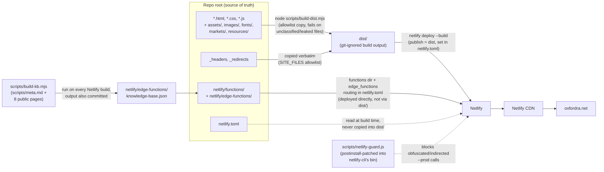
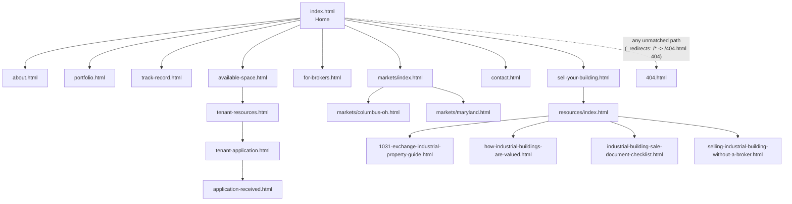
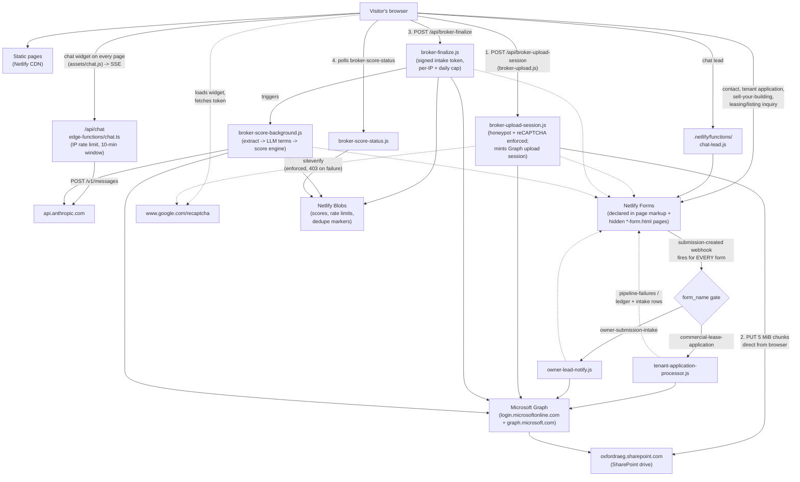

# oxfordra.net — Oxford Realty Advisors Website

Source repository for [oxfordra.net](https://oxfordra.net), the public marketing website for Oxford Realty Advisors (ORA), a private family-office industrial real estate investor. The site serves three audiences — industrial tenants and prospects looking for space (`available-space`, `tenant-resources`, `tenant-application`), brokers and building owners with deals to sell (`for-brokers`, `sell-your-building`, `resources/`), and general firm diligence (`about`, `portfolio`, `track-record`). It is a static multi-page HTML/CSS/JS site with a handful of Netlify Functions (form intake, broker OM scoring) and an edge-function-backed chat assistant, deployed to Netlify.

## Architecture

### Build & deploy flow


<!-- diagram-verified: 2026-08-21 -->

**Reading the diagram:** the repo root deliberately mixes **public site content** with **internal tooling** (scripts, tests, evals, function source). `scripts/build-dist.mjs` is the boundary: it enumerates every root entry one-by-one into either a publish allowlist (`SITE_FILES`/`SITE_DIRS`) or an explicit exclusion list (`EXPECTED_EXCLUSIONS`), and **fails the build** on anything unclassified — a new file can neither silently ship nor silently vanish. After copying it re-checks that `scripts`, `evals`, `netlify`, and `netlify.toml` did not leak into `dist/`, that every required file is present, and that at least 14 HTML pages were published. `netlify.toml` is itself one of those excluded-and-banned entries: Netlify reads it from the repo root at build time, so it is never published. It sets `publish = "dist"` and `command = "node scripts/build-kb.mjs && node scripts/build-dist.mjs"`, so every Netlify build first regenerates the chat assistant's knowledge base from current page content, then reassembles `dist/` from source before anything is served — editing a page (or `scripts/meta.md`) now takes effect on the next deploy with no separate manual step (fixed 2026-08-16, OI-165; previously `build-kb.mjs` ran only by hand, so a page edit didn't change what the assistant knew until someone remembered to re-run it). `netlify/edge-functions/knowledge-base.json` stays committed too, both so a local checkout has an inspectable current copy and so `git diff` on it flags exactly which pages changed.

### Site content structure



`_redirects` also 301s a set of legacy Squarespace and Wix paths (e.g. `/team`, `/investments`, `/portfolio-1`) onto the current pages shown above — do not remove those without confirming the old paths are no longer indexed. `privacy.html` and `terms.html` hang off the site-wide footer rather than this tree; the four `*-form.html` pages are hidden Netlify Forms declarations, not navigable pages (see below).

### Request & data flow



**Reading the diagram:** most of what the visitor touches is same-origin, but the browser itself makes two direct cross-origin calls in these flows: it loads Google's reCAPTCHA widget during the broker-upload honeypot step, and it `PUT`s a broker's offering memorandum straight to SharePoint in 5 MiB chunks — both `www.google.com` and `oxfordraeg.sharepoint.com` sit in the `connect-src` allowlist in `_headers` for exactly these reasons (a third entry, `*.tile.openstreetmap.org`, backs the markets-page maps and is unrelated to this flow). Server-side, the only outbound calls are Microsoft Graph (auth, SharePoint file writes, and all outbound mail), the Anthropic API (the `/api/chat` assistant and the broker deal-term extraction), and Google's reCAPTCHA siteverify endpoint — enforced, 403 on failure (`broker-upload-session.js`; disabled 2026-07-19 to 2026-09-07 after a client-side site-key typo, re-enabled once fixed and verified); there is no database — durable state is Netlify Blobs (score results, per-IP rate limits, daily caps, dedupe markers) plus Netlify Forms, which doubles as the failure log every function writes to via the `pipeline-failures` form. Two functions are never linked from a page or called by client JS: `tenant-application-processor.js` and `owner-lead-notify.js` are wired as Netlify `submission-created` outgoing webhooks — Netlify itself POSTs to each function's URL on every form submitted anywhere on the site, and each gates on `form_name` — that gate is load-bearing, not defensive. The broker pipeline is the only multi-step flow: session, direct upload, finalize, then an out-of-band background scoring job the page polls for.

## Repo layout

```
├── *.html                    Public pages (index, about, portfolio, contact, ...)
├── *.css / *.js               Shared styles and client-side scripts
├── assets/, images/, fonts/   Static site assets (copied verbatim to dist/)
├── markets/                   Per-market landing pages (Columbus OH, Maryland)
├── resources/                 Seller-focused guide pages (1031 exchange, valuation, ...)
├── netlify/
│   ├── functions/             Netlify Functions (forms, broker OM intake, lead notify)
│   │   └── _shared/           Shared helpers (Graph API auth/mail/files, validation, scoring)
│   └── edge-functions/        Edge function for the /api/chat assistant + its knowledge base
├── .github/workflows/ci.yml    PR gate — runs `npm run verify` (plus a manual chat-eval job)
├── scripts/
│   ├── build-dist.mjs         Assembles dist/ for deploy (see above)
│   ├── build-kb.mjs           Builds the chat assistant's knowledge base
│   ├── serve-dist.mjs         Static server for dist/ that APPLIES _headers (CSP); `npm run serve`
│   ├── verify-jsonld.mjs      Runs validate-jsonld.js over every built page + required-page floor
│   ├── run-unit-tests.mjs     Enumerates *.test.js and calls `node --test` (Node 20/24 portable)
│   ├── eval-chat.mjs          Runs the chat assistant eval suite (see evals/)
│   ├── validate-jsonld.js     Validates JSON-LD structured data on ONE page
│   ├── netlify-guard.js       Blocks indirected/obfuscated `netlify deploy --prod` calls
│   ├── patch-netlify-shim.js  postinstall hook wiring netlify-guard.js into netlify-cli's bin
│   └── meta.md                Canonical firm facts fed into the chat assistant's knowledge base
├── tests/functions/            node:test unit tests for netlify/functions/
├── tests/site/                 Headless-browser CSP gate + Netlify-runtime function smoke test
├── evals/                      Chat assistant eval fixtures + dated result runs
├── dist/                       BUILD OUTPUT — git-ignored, assembled by build-dist.mjs
├── _headers                    Netlify response headers (CSP, caching, HSTS, preloads)
├── _redirects                  Netlify redirects (legacy Squarespace/Wix paths, non-www enforcement)
├── netlify.toml                Netlify build/publish/functions/edge-function config
├── sitemap.xml, robots.txt, llms.txt   Search + LLM-crawler discovery files
└── docs/superpowers/            Session-local planning artifacts — git-ignored, not site content
```

## Local development

There is no site compiler — pages are hand-authored static HTML — but there *is* a build step: `dist/` is assembled from an explicit allowlist, and the chat assistant's knowledge base is regenerated from site content.

```bash
npm ci                         # installs netlify-cli (pinned v26.2.0) + playwright + deps;
                               # postinstall runs scripts/patch-netlify-shim.js,
                               # which wires netlify-guard.js into netlify-cli's bin
npx playwright install chromium  # one-time, for the CSP smoke test
npm run build                  # build-kb.mjs + build-dist.mjs — exactly what netlify.toml runs
npm run serve                  # serve dist/ on :8788 WITH _headers applied (see below)
```

`npm run serve` uses `scripts/serve-dist.mjs`, which parses `_headers` and applies it to every response. Use it rather than a generic static server for any manual browser check: an ordinary static server sends no CSP header at all, so the page will appear to work while every allowlist bug stays invisible.

`npm ci` pins `netlify-cli` to a tested version so deploys resolve a local install rather than depending on `npx`'s evictable cache.

**Deploys to production require separate, explicit permission** — this is a standing rule for this repo (Hard Invariant 2). Editing `README.md` or any other file here does not deploy anything by itself; `dist/` and the live site are only touched by an explicit, confirmed `netlify deploy` invocation.

## Testing

`npm run verify` is the whole gate. `.github/workflows/ci.yml` runs exactly this command on every pull request, so a red CI run reproduces locally with one command and no arguments.

```bash
npm run verify           # build -> jsonld -> unit -> CSP -> functions runtime
```

Its five stages, each also runnable alone:

| Command | What it proves | Why it can't be a unit test |
|---|---|---|
| `npm run build` | `dist/` assembles; every root entry is classified as published or private | — |
| `npm run verify:jsonld` | every page's JSON-LD parses, **and** the key pages still have a block at all | — |
| `npm run test:unit` | function/module logic (`node:test`, no framework dependency) | — |
| `npm run test:site` | four representative pages load with **zero CSP violations** in headless Chromium, served with `_headers` applied | CSP is a property of a served response plus a real renderer; `require()` cannot see it |
| `npm run test:functions` | `chat-lead` behaves correctly when driven over HTTP through `netlify functions:serve` | a `require()`d handler cannot reveal a runtime-shape mismatch (CJS vs. V2 function runtime) |

Unit tests live in `tests/functions/`; the browser and Netlify-runtime smoke tests live in `tests/site/`. `application-script.file-size.test.js` at the repo root guards the size of the hand-written DOM script rather than testing exports (it has none — it's a DOM IIFE).

`tests/site/functions-smoke.test.mjs` is written as an extensible template: `invokeFunction()` and the server harness are generic, so covering another function is a matter of adding cases. It deliberately covers only a non-broker function.

The chat assistant has a separate eval harness (`scripts/eval-chat.mjs` against fixtures in `evals/fixtures.json`, dated snapshots retained in `evals/`). It is **not** in `npm run verify`: it needs a live `/api/chat` origin and spends real model tokens per case. Run it against a deploy preview instead — `npm run eval:chat -- --base=https://<preview>.netlify.app`, or via the CI workflow's manual `eval-chat` job.

### What CI still can't catch

- **Netlify Blobs credential injection.** `functions:serve` does not provision a real Blobs store, so the smoke test proves the runtime-shape contract, not credential auto-injection. That still needs a deploy preview.
- **reCAPTCHA verdicts.** Google will not mint real tokens for a headless localhost origin. CI proves the widget's script/frame origins are CSP-allowed (the failure mode that silently kills it), not that a real token verifies server-side.

## Key pages

| Page | Purpose |
|---|---|
| `index.html` | Home — firm overview, investment criteria, featured acquisitions |
| `about.html` | Firm history, leadership, investment strategy |
| `portfolio.html` | Owned industrial/flex property portfolio |
| `track-record.html` | Case studies and investment performance |
| `available-space.html` | Current industrial/flex leasing availability |
| `tenant-resources.html` | Resources for current and prospective tenants |
| `tenant-application.html` / `application-received.html` | Tenant lease application form + confirmation |
| `for-brokers.html` | Deal submission, investment criteria, broker incentives |
| `sell-your-building.html` | Direct-to-owner sale process, all-cash offer terms, seller FAQ |
| `resources/index.html` + 4 guide pages | Seller guides — 1031 exchange, valuation, sale-document checklist, selling without a broker |
| `markets/index.html`, `markets/columbus-oh.html`, `markets/maryland.html` | Core-market overview + per-market portfolio/market data |
| `contact.html` | Contact information |
| `privacy.html`, `terms.html` | Privacy policy, terms of use |
| `404.html` | Not-found page, served for all unmatched paths via `_redirects` |
| `broker-intake-form.html`, `broker-ledger-form.html`, `chat-lead-form.html`, `pipeline-failures-form.html` | Internal-only form pages (titled "(internal)"), still published — not linked from site nav |

## Netlify Functions

| Function | Purpose |
|---|---|
| `chat-lead.js` | Captures leads submitted via the chat assistant |
| `broker-upload-session.js` / `broker-finalize.js` | Broker OM (offering memorandum) upload intake pipeline |
| `broker-score-background.js` / `broker-score-status.js` | Async scoring of submitted broker deals against ORA's buy-box |
| `owner-lead-notify.js` | Notifies on direct-to-owner ("sell your building") lead submissions |
| `tenant-application-processor.js` | Processes tenant lease applications |
| `edge-functions/chat.ts` | Edge function powering the `/api/chat` assistant, backed by `edge-functions/knowledge-base.json` (built by `scripts/build-kb.mjs` from `scripts/meta.md` + site content) |

Shared helpers (Microsoft Graph auth/mail/file access, reCAPTCHA verification, form validation, broker-score engine) live in `netlify/functions/_shared/`.

## Headers & CSP

`_headers` (source of truth, not duplicated in `netlify.toml`) sets, for all paths:

- `Content-Security-Policy` — `default-src 'self'`, with explicit allowances for Google Tag Manager, Google reCAPTCHA, `unpkg.com` (scripts + styles), Netlify RUM, Google Analytics/`doubleclick.net`, OpenStreetMap tiles, and the firm's SharePoint domain (`oxfordraeg.sharepoint.com`) for `connect-src`; plus `object-src 'none'`, `base-uri 'self'`, `form-action 'self'` and `frame-ancestors 'none'`. The LinkedIn Insight origins were removed 2026-09-25 with the placeholder tag; re-add them with the real Partner ID.
- `X-Frame-Options: DENY`, `X-Content-Type-Options: nosniff`, `Referrer-Policy: strict-origin-when-cross-origin`, `Permissions-Policy` (camera/microphone/geolocation all disabled), and HSTS with `preload`.
- Long-lived immutable caching (`max-age=31536000`) for `/images/*`, `/fonts/*`, `*.css`, `*.js`; `must-revalidate` for `*.html`; 1-day caching for `*.pdf`.
- Font and hero-image `Link: rel=preload` hints on `/` and `/index.html` (four self-hosted webfonts + the homepage hero image, `fetchpriority=high`).

The CSP allowlist is now enforced pre-merge by `npm run test:site`. Adding a third-party script, style, font, frame, or XHR origin to any page without adding it to the matching `_headers` directive will fail the PR with the blocked URI and the directive that blocked it — instead of surfacing as a console error on the live site after deploy.

## Content notes

- `scripts/meta.md` holds canonical firm facts (leadership, markets, deal parameters, contact info) that feed the chat assistant's knowledge base — update it, not individual pages, when firm-level facts change.
- `_redirects` carries permanent 301s from the site's prior Squarespace and Wix incarnations; do not remove these without confirming the old paths are no longer indexed.
- `llms.txt` is a machine-readable summary for LLM crawlers — keep its key-pages list in sync with actual site navigation.

## Related

- `.claude/` — machine-local Claude Code tooling config (`launch.json` is git-ignored; not part of the deployed site)
- `docs/superpowers/` — session planning artifacts, git-ignored, not site content
