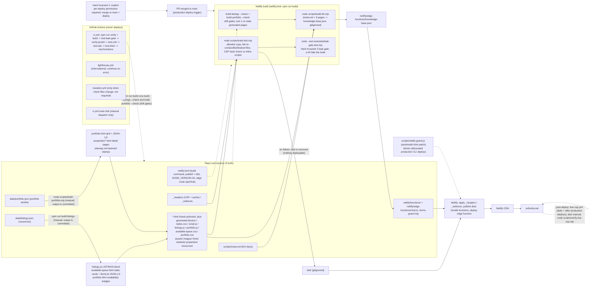
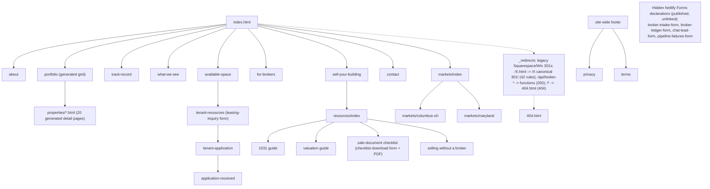
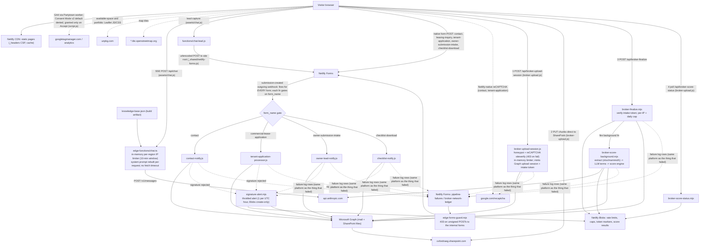
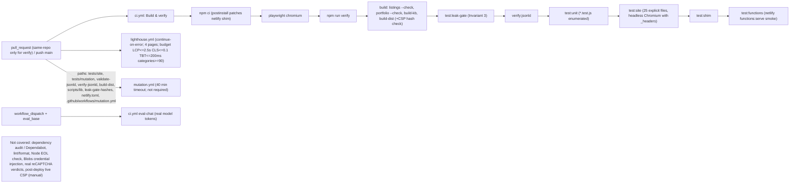
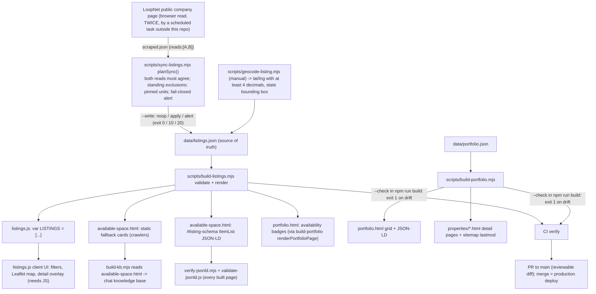

# oxfordra.net — Oxford Realty Advisors Website

Source repository for [oxfordra.net](https://oxfordra.net), the public marketing website for Oxford Realty Advisors (ORA), a private family-office industrial real estate investor. The site serves three audiences — industrial tenants and prospects looking for space (`available-space`, `tenant-resources`, `tenant-application`), brokers and building owners with deals to sell (`for-brokers`, `sell-your-building`, `resources/`), and general firm diligence (`about`, `portfolio`, `track-record`). It is a static multi-page HTML/CSS/JS site with a handful of Netlify Functions (form intake and notification, broker OM scoring) and an edge-function-backed chat assistant, deployed to Netlify. The Available Space page is data-driven: `data/listings.json` is the single source of truth and is compiled into committed markup (see [Available-space listings](#available-space-listings)).

## Architecture

### Build & deploy flow


<!-- diagram-verified: 2026-10-28 -->

Note that `netlify.toml` runs `npm run build` followed by the leak-gate test (`node --test tests/site/leak-gate.test.mjs`, the Hard Invariant 3 gate, see `docs/leak-gate.md`; a hit fails the build, previews included), so the two `--check` drift gates (listings, portfolio) run in the Netlify build as well as in CI via `npm run verify`; a stale generated artifact fails the deploy build.

**Reading the diagram:** the repo root deliberately mixes **public site content** with **internal tooling** (scripts, tests, evals, function source). `scripts/build-dist.mjs` is the boundary: it enumerates every root entry one-by-one into either a publish allowlist (`SITE_FILES`/`SITE_DIRS`) or an explicit exclusion list (`EXPECTED_EXCLUSIONS`), and **fails the build** on anything unclassified — a new file can neither silently ship nor silently vanish. After copying it re-checks that `scripts`, `evals`, `netlify`, and `netlify.toml` did not leak into `dist/`, that every required file is present, that at least 14 HTML pages were published, and that the inline-script hashes in `_headers` match the pages being published (a missing or stale hash, or `'unsafe-inline'` in `script-src`, fails the build). `netlify.toml` is itself one of those excluded-and-banned entries: Netlify reads it from the repo root at build time, so it is never published. It sets `publish = "dist"`, `NODE_VERSION = "20"`, and `command = "npm run build"`, so every Netlify build first runs the listings and portfolio drift gates, then regenerates the chat assistant's knowledge base from current page content, then reassembles `dist/` from source before anything is served — editing a page (or `scripts/meta.md`) now takes effect on the next deploy with no separate manual step (fixed 2026-08-16, OI-165; previously `build-kb.mjs` ran only by hand, so a page edit didn't change what the assistant knew until someone remembered to re-run it). `netlify/edge-functions/knowledge-base.json` is **not** committed: it is a gitignored build artifact regenerated by every Netlify build and by `npm run build` / `npm run verify`, so it never shows up dirty in a worktree and cannot go stale in git (it had sat three weeks behind the pages). Run `npm run build` once in a fresh checkout before using `netlify dev`, since `chat.ts` imports it.

`npm run build` is the Netlify build command (`netlify.toml` runs it, then the leak-gate test): it first runs `scripts/build-listings.mjs --check` (fails if `listings.js`, `available-space.html` or the portfolio availability badges have drifted from `data/listings.json`) and `scripts/build-portfolio.mjs --check` (fails if `portfolio.html` or `properties/*.html` have drifted from `data/portfolio.json`), then `build-kb.mjs` and `build-dist.mjs`. The drift checks therefore gate PRs via `npm run verify` and also gate the Netlify production build; `npm run verify` runs the leak-gate test right after the build, and the Netlify command appends it. The two root PDFs (`Oxford-Realty-Advisors-Overview.pdf`, `Oxford-Sale-Ready-Checklist.pdf`) are committed artifacts rendered by hand with `scripts/overview-pdf/build-overview-pdf.mjs` and `scripts/checklist-pdf/build-checklist-pdf.mjs` (headless Chromium, so the text layer is extractable); they are not rebuilt on deploy.

### Site content structure


<!-- nav edges for home, portfolio -> properties and markets verified by link grep 2026-10-06; the remaining edges are carried over unchanged -->

Static assets published alongside: `/assets` (chat.js, chat.css, Partytown), `/images`, `/fonts` (four woff2), the two root PDFs, `sitemap.xml`, `robots.txt`, `llms.txt`, `manifest.json`.

`_redirects` also 301s a set of legacy Squarespace and Wix paths (e.g. `/team`, `/investments`, `/portfolio-1`) onto the current pages shown above — do not remove those without confirming the old paths are no longer indexed. `privacy.html` and `terms.html` hang off the site-wide footer rather than this tree; the four `*-form.html` pages are hidden Netlify Forms declarations, not navigable pages (see below).

### Request & data flow



**Reading the diagram:** most of what the visitor touches is same-origin, but the browser itself makes two direct cross-origin calls in these flows: it loads Google's reCAPTCHA widget during the broker-upload honeypot step, and it `PUT`s a broker's offering memorandum straight to SharePoint in 5 MiB chunks — both `www.google.com` and `oxfordraeg.sharepoint.com` sit in the `connect-src` allowlist in `_headers` for exactly these reasons (a third entry, `*.tile.openstreetmap.org`, backs the markets-page maps and is unrelated to this flow). Server-side, the only outbound calls are Microsoft Graph (auth, SharePoint file writes, and all outbound mail), the Anthropic API (the `/api/chat` assistant and the broker deal-term extraction), and Google's reCAPTCHA siteverify endpoint — enforced, 403 on failure (`broker-upload-session.js`; disabled 2026-07-19 to 2026-09-07 after a client-side site-key typo, re-enabled once fixed and verified); there is no database — durable state is Netlify Blobs (broker score results, the `broker-finalize` per-IP rate limit and daily cap, dedupe markers) plus Netlify Forms, which doubles as the failure log every function writes to via the `pipeline-failures` form. Four functions are never linked from a page or called by client JS: `tenant-application-processor.js`, `owner-lead-notify.js`, `contact-notify.js` and `checklist-notify.js` are wired as Netlify `submission-created` outgoing webhooks — Netlify itself POSTs to each function's URL on every form submitted anywhere on the site, and each gates on `form_name` — that gate is load-bearing, not defensive. The `/api/chat` and `broker-upload-session` per-IP limiters are in-memory per instance (not shared across instances or durable). Analytics runs through Google Consent Mode v2: the inline gtag script on each page defaults analytics storage to denied, `script.js` grants it only on a cookie-banner Accept, and Decline leaves the default in place. The map pages (`available-space.html`, and `portfolio.js` on the portfolio page) load Leaflet from `unpkg.com`. The broker pipeline is the only multi-step flow: session, direct upload, finalize, then an out-of-band background scoring job the page polls for.

## Repo layout

```
├── *.html                    Public pages (index, about, portfolio, contact, ...)
├── *.css / *.js               Shared styles and client-side scripts (listings.js is GENERATED in part - see below)
├── portfolio.css, portfolio.js, available-space.css   Page-specific styles/scripts (portfolio.html is GENERATED in part - see below)
├── data/listings.json         Source of truth for Available Space listings
├── data/portfolio.json        Source of truth for the portfolio grid and the properties/ detail pages
├── assets/, images/, fonts/   Static site assets (copied verbatim to dist/)
├── properties/                Per-property detail pages - GENERATED by build-portfolio.mjs (do not hand-edit)
├── markets/                   Per-market landing pages (Columbus OH, Maryland)
├── resources/                 Seller-focused guide pages (1031 exchange, valuation, ...)
├── netlify/
│   ├── functions/             Netlify Functions (forms, broker OM intake, lead notify)
│   │   └── _shared/           Shared helpers (Graph API auth/mail/files, validation, scoring)
│   └── edge-functions/        chat.ts (the /api/chat assistant + its knowledge base) and forms-guard.mjs (403s unsigned POSTs to the internal forms)
├── .github/workflows/
│   ├── ci.yml                 PR gate — runs `npm run verify` (plus a manual chat-eval job)
│   ├── live-csp.yml           Daily/post-deploy check that the served CSP allows every served inline script (read-only; see scripts/verify-live-csp.mjs)
│   ├── lighthouse.yml         Informational Lighthouse budget on 4 built pages; never fails a PR (see scripts/lighthouse-summary.mjs)
│   └── mutation.yml           Mutation tests of the site checks; runs on PRs touching the checks, or on demand
├── scripts/
│   ├── build-dist.mjs         Assembles dist/ for deploy (see above)
│   ├── build-kb.mjs           Builds the chat assistant's knowledge base
│   ├── build-listings.mjs     Regenerates listings.js + available-space.html (and the portfolio availability badges) from data/listings.json (--check = drift gate)
│   ├── build-portfolio.mjs    Regenerates portfolio.html + properties/*.html from data/portfolio.json and stamps sitemap lastmod (--check = drift gate)
│   ├── sync-listings.mjs      Reconciles a LoopNet read against data/listings.json (see Available-space listings)
│   ├── geocode-listing.mjs    US Census geocoder lookup for a new listing's lat/lng
│   ├── csp-hashes.mjs         Computes/checks/writes the inline-script hashes in _headers
│   ├── verify-live-csp.mjs    Post-deploy check of the CSP actually served (live site or a deploy preview)
│   ├── lighthouse-summary.mjs Summarises Lighthouse reports against the budget (informational)
│   ├── lighthouse-run.mjs     Runs Lighthouse against the built pages
│   ├── stamp-asset-versions.mjs Stamps asset version query strings into built pages
│   ├── leak-gate-hashes.mjs / leak-gate-hashes.json  Salted-hash denylist builder and its data (see docs/leak-gate.md)
│   ├── lib/                   Shared script helpers
│   ├── overview-pdf/, checklist-pdf/  Render the two root PDFs with headless Chromium (manual)
│   ├── serve-dist.mjs         Static server for dist/ that APPLIES _headers (CSP); `npm run serve`
│   ├── verify-jsonld.mjs      Runs validate-jsonld.js over every built page + required-page floor
│   ├── run-unit-tests.mjs     Enumerates *.test.js and calls `node --test` (Node 20/24 portable)
│   ├── eval-chat.mjs          Runs the chat assistant eval suite (see evals/)
│   ├── validate-jsonld.js     Validates JSON-LD structured data on ONE page
│   ├── netlify-guard.js       Blocks indirected/obfuscated `netlify deploy --prod` calls
│   ├── patch-netlify-shim.js  postinstall hook wiring netlify-guard.js into netlify-cli's bin
│   └── meta.md                Canonical firm facts fed into the chat assistant's knowledge base
├── tests/functions/            node:test unit tests for netlify/functions/ (and _shared/)
├── tests/listings/             Unit tests for build-listings, sync-listings, geocode-listing
├── tests/portfolio/            Unit tests for build-portfolio and portfolio page content rules
├── tests/client/, tests/scripts/  Unit tests for broker-upload.js retry logic and lighthouse-summary
├── tests/site/                 Build-output checks: CSP (headless Chromium), SEO, forms, a11y, listings/map UI, Netlify-runtime smoke test
├── tests/mutation/             Mutation harness: breaks a copy of the site and requires the named check to fail
├── evals/                      Chat assistant eval fixtures + dated result runs
├── dist/                       BUILD OUTPUT — git-ignored, assembled by build-dist.mjs
├── _headers                    Netlify response headers (CSP, caching, HSTS, preloads)
├── _redirects                  Netlify redirects (legacy Squarespace/Wix paths, non-www enforcement)
├── netlify.toml                Netlify build/publish/functions/edge-function config
├── sitemap.xml, robots.txt, llms.txt   Search + LLM-crawler discovery files
└── docs/superpowers/            Session-local planning artifacts — git-ignored, not site content (the only tracked docs/ file is `docs/leak-gate.md`)
```

## Local development

There is no site compiler — pages are hand-authored static HTML — but there *is* a build step: `dist/` is assembled from an explicit allowlist, and the chat assistant's knowledge base is regenerated from site content.

```bash
npm ci                         # installs netlify-cli (pinned 26.2.0) + playwright + deps;
                               # postinstall runs scripts/patch-netlify-shim.js,
                               # which wires netlify-guard.js into netlify-cli's bin
npx playwright install chromium  # one-time, for the CSP smoke test
npm run build                  # build-listings --check + build-portfolio --check + build-kb + build-dist (what netlify.toml runs, followed by the leak-gate test)
npm run build:listings         # regenerate listings.js + available-space.html after editing data/listings.json
npm run serve                  # serve dist/ on :8788 WITH _headers applied (see below)
```

`npm run serve` uses `scripts/serve-dist.mjs`, which parses `_headers` and applies it to every response. Use it rather than a generic static server for any manual browser check: an ordinary static server sends no CSP header at all, so the page will appear to work while every allowlist bug stays invisible.

`npm ci` pins `netlify-cli` to a tested version so deploys resolve a local install rather than depending on `npx`'s evictable cache.

**Deploys to production require separate, explicit permission** — this is a standing rule for this repo (Hard Invariant 2). Editing `README.md` or any other file here does not deploy anything by itself; `dist/` and the live site are only touched by an explicit, confirmed `netlify deploy` invocation.

## Testing

`npm run verify` is the whole gate. `.github/workflows/ci.yml` runs exactly this command on every pull request and on pushes to `main`, so a red CI run reproduces locally with one command and no arguments.

```bash
npm run verify           # build -> leak-gate -> jsonld -> unit -> site -> shim -> functions runtime
```

Its seven stages, each also runnable alone:

| Command | What it proves | Why it can't be a unit test |
|---|---|---|
| `npm run build` | listings copies match `data/listings.json` and the portfolio page/detail pages match `data/portfolio.json`; knowledge base builds; `dist/` assembles with every root entry classified and CSP hashes current | — |
| `npm run test:leak-gate` | Hard Invariant 3: no active confidential-deal term (salted-hash denylist, see `docs/leak-gate.md`) in `dist/`, tracked files, data, edge functions or PDFs; also run by the Netlify build | — |
| `npm run verify:jsonld` | every page's JSON-LD parses, **and** the key pages still have a block at all | — |
| `npm run test:unit` | function/module logic (`node:test`, no framework dependency; `scripts/run-unit-tests.mjs` enumerates every `*.test.js` under `tests/` except `tests/site/`, plus `application-script.file-size.test.js` and `assets/chat.test.js`) | — |
| `npm run test:site` | the explicit list of 25 `tests/site/*.test.mjs` files in `package.json`: CSP smoke (four pages load with zero CSP violations in headless Chromium, served with `_headers` applied), CSP hashes and all-pages CSP, SEO and entity markup, analytics, Netlify Forms declarations, form validator, site integrity and plumbing, mobile nav, client robustness, upload budget, listings, map and portfolio-map UI, cookie banner, announcement-bar contrast, contact copy and form hint, Consent Mode v2 ordering and Accept/Decline state through Partytown (real browser), logo a11y, reCAPTCHA site key, `serve-dist` args | CSP is a property of a served response plus a real renderer; `require()` cannot see it |
| `npm run test:shim` | `scripts/patch-netlify-shim.js` replaces netlify-cli's bin entry instead of writing through a POSIX symlink (regression test against a disposable fixture) | the failure only exists on the POSIX bin-link layout |
| `npm run test:functions` | `chat-lead` behaves correctly when driven over HTTP through `netlify functions:serve` | a `require()`d handler cannot reveal a runtime-shape mismatch (CJS vs. V2 function runtime) |

**Coverage guard:** `tests/site/` is enumerated by hand in `package.json` (`run-unit-tests.mjs` skips it), so a new file nobody appends would silently never run. `tests/scripts/test-classification.test.js` (part of `test:unit`) fails if any `tests/site/*.test.mjs` is in none of `test:site`, `test:functions`, `test:shim` or `test:leak-gate` (or an `EXCLUDED` list with a written reason), or if a script names a file that does not exist.

Unit tests live in `tests/functions/` (plus `tests/functions/_shared/`), `tests/listings/`, `tests/portfolio/`, `tests/client/` and `tests/scripts/`; the browser, build-output and Netlify-runtime tests live in `tests/site/`. `application-script.file-size.test.js` at the repo root guards the size of the hand-written DOM script rather than testing exports (it has none — it's a DOM IIFE).

`tests/site/functions-smoke.test.mjs` is written as an extensible template: `invokeFunction()` and the server harness are generic, so covering another function is a matter of adding cases. It deliberately covers only `chat-lead`, a non-broker function.

**Mutation tests** (`npm run test:mutation`, `.github/workflows/mutation.yml`) are separate from `verify`. `tests/mutation/run.mjs` copies the repo to a temp dir, confirms every check is green, then applies each break in `tests/mutation/cases.mjs` one at a time and requires the named check to fail, so a check that quietly stops catching its breakage is itself caught. The workflow runs on PRs that touch `tests/site/**`, `tests/mutation/**`, the JSON-LD scripts, `build-dist.mjs`, `scripts/lib/**`, `scripts/leak-gate-hashes.*` or `netlify.toml`, and on demand; it is not a required check.

**Lighthouse** (`.github/workflows/lighthouse.yml`) runs on PRs against the built, header-serving `dist/` for four pages (home, for-brokers, available-space, sell-your-building) and reports against the site's budget. It is informational only (`continue-on-error`) and never fails a PR.

The chat assistant has a separate eval harness (`scripts/eval-chat.mjs` against fixtures in `evals/fixtures.json`, dated snapshots retained in `evals/`). It is **not** in `npm run verify`: it needs a live `/api/chat` origin and spends real model tokens per case. Run it against a deploy preview instead — `npm run eval:chat -- --base=https://<preview>.netlify.app`, or via the CI workflow's manual `eval-chat` job (Actions -> CI -> Run workflow, `eval_base` input).

CI picks its runner from the `CI_RUNNER` repository variable (a JSON label array); unset means GitHub-hosted `ubuntu-24.04` (pinned: `ubuntu-latest` is Ubuntu 26.04, where Playwright 1.56.1 cannot install Chromium). Fork PRs never run on a self-hosted runner. No workflow deploys.

### CI gates at a glance



### What CI still can't catch

- **Netlify Blobs credential injection.** `functions:serve` does not provision a real Blobs store, so the smoke test proves the runtime-shape contract, not credential auto-injection. That still needs a deploy preview.
- **reCAPTCHA verdicts.** Google will not mint real tokens for a headless localhost origin. CI proves the widget's script/frame origins are CSP-allowed (the failure mode that silently kills it), not that a real token verifies server-side.

## Key pages

| Page | Purpose |
|---|---|
| `index.html` | Home — firm overview, investment criteria, featured acquisitions |
| `about.html` | Firm history, leadership, investment strategy |
| `portfolio.html` | Owned industrial/flex property portfolio (grid and JSON-LD generated from `data/portfolio.json`) |
| `properties/*.html` | 20 per-property detail pages, generated by `scripts/build-portfolio.mjs` |
| `what-we-see.html` | How Oxford Sees Small Industrial (in the chat knowledge base) |
| `track-record.html` | Case studies and investment performance |
| `available-space.html` | Current industrial/flex leasing availability |
| `tenant-resources.html` | Resources for current and prospective tenants |
| `tenant-application.html` / `application-received.html` | Tenant lease application form + confirmation |
| `for-brokers.html` | Deal submission, investment criteria, broker incentives |
| `sell-your-building.html` | Direct-to-owner sale process, all-cash offer terms, seller FAQ |
| `resources/index.html` + 4 guide pages | Seller guides — 1031 exchange, valuation, sale-document checklist, selling without a broker |
| `markets/index.html`, `markets/columbus-oh.html`, `markets/maryland.html` | Core-market overview + per-market portfolio/market data |
| `contact.html` | Contact information |
| `privacy.html`, `terms.html` | Privacy policy, terms of use |
| `404.html` | Not-found page, served for all unmatched paths via `_redirects` |
| `broker-intake-form.html`, `broker-ledger-form.html`, `chat-lead-form.html`, `pipeline-failures-form.html` | Hidden Netlify Forms declaration pages, still published — not linked from site nav |

## Netlify Functions

All live in `netlify/functions/` unless noted. The four `submission-created` webhook targets are not routed by URL from the site; the broker endpoints are exposed as `/api/broker-upload-session`, `/api/broker-finalize` and `/api/broker-score-status` via `_redirects`.

| Function | Purpose |
|---|---|
| `chat-lead.js` | Captures leads submitted via the chat assistant into the `chat-lead` form |
| `broker-upload-session.js` / `broker-finalize.mjs` | Broker OM (offering memorandum) upload intake pipeline (session mint with reCAPTCHA + rate limit; finalize with signed intake token, per-IP limit and daily cap) |
| `broker-score-background.mjs` / `broker-score-status.mjs` | Async scoring of submitted broker deals against ORA's buy-box (V2 functions; Netlify Blobs for results) |
| `owner-lead-notify.js` | `submission-created` webhook: notifies on direct-to-owner ("sell your building") submissions (`owner-submission-intake`) |
| `tenant-application-processor.js` | `submission-created` webhook: processes tenant lease applications (`commercial-lease-application`) |
| `contact-notify.js` | `submission-created` webhook: emails on `contact` form submissions |
| `checklist-notify.js` | `submission-created` webhook: notifies on `checklist-download` form submissions from the sale-document checklist guide |
| `signature-alert.mjs` | V2 function called by the four webhook targets when a webhook signature is rejected; sends a throttled alert (1 per UTC hour, Netlify Blobs create-only) to ggoldberg@oxfordra.net via Graph |
| `edge-functions/chat.ts` | Edge function powering the `/api/chat` assistant (Anthropic Messages API; model overridable via `CHAT_MODEL`), backed by `edge-functions/knowledge-base.json` (built by `scripts/build-kb.mjs` from `scripts/meta.md` + 9 site pages) |

Shared helpers in `netlify/functions/_shared/`: Microsoft Graph auth, mail and file access (`graph-auth.js`, `graph-mail.js`, `graph-files.js`), reCAPTCHA verification (`recaptcha.js`), Netlify Forms posting (`netlify-forms.js`), form validation and signed tokens (`validate.js`), the email template, and the broker pipeline modules (text extraction, LLM term extraction, score engine, score store, scoring run, RCT benchmark data). Functions that go through Blobs are ESM (`.mjs`) and must not export `handler`; `tests/functions/broker-v2-runtime-contract.test.js` and `esm-cjs-bundling-contract.test.js` pin that contract.

## Available-space listings

`data/listings.json` is the single source of truth for available space. `node scripts/build-listings.mjs` (`npm run build:listings`) regenerates three committed copies: the `LISTINGS` block in `listings.js`, the static fallback cards in `available-space.html` (what crawlers see before JS runs), and the `listing-schema` JSON-LD `ItemList`. `--check` (run by `npm run build`) exits 1 on drift, so a listings PR shows the exact served markup in its diff. Validation rejects missing fields, lat/lng with fewer than 4 decimals, coordinates outside the listing's state, and unknown rate types.

- New listing coordinates: `node scripts/geocode-listing.mjs "<street>, <city>, <ST>"` (US Census geocoder; interpolates along the street, so confirm the pin against parcel or aerial data).
- `scripts/sync-listings.mjs` reconciles a LoopNet read (supplied as JSON by an external browser-based scheduled task, read twice and required to agree) against `data/listings.json`; outcomes are noop, apply, or alert (guard tripped, fails closed). That scheduled task is not defined in this repo.

`data/portfolio.json` is the equivalent source for the portfolio page. `node scripts/build-portfolio.mjs` rewrites the grid, market mix and `ItemList` JSON-LD in `portfolio.html` between its `portfolio:*:begin/end` markers, regenerates each `properties/*.html` detail page, and stamps `sitemap.xml` `<lastmod>` for every page it changes; `--check` (run by `npm run build`) exits 1 on drift. A `properties/` page that the data no longer generates fails the build rather than being deleted. `build-listings.mjs` also regenerates `portfolio.html` (through `renderPortfolioPage`), which keeps the availability badges current after the weekly sync.



## Headers & CSP

`_headers` (source of truth, not duplicated in `netlify.toml`) sets, for all paths:

- `Content-Security-Policy` — `default-src 'self'`, with explicit allowances for Google Tag Manager, Google reCAPTCHA, `unpkg.com` (only the exact Leaflet 1.9.4 `leaflet.js` and `leaflet.css` files, never the whole host; pinned by csp-hashes CSP-7), Netlify RUM (`netlify-rum.netlify.app`, plus the exact collector `ingesteer.services-prod.nsvcs.net` in `connect-src`, pinned by seo test WP-17), Google Analytics/`doubleclick.net`, OpenStreetMap tiles, and the firm's SharePoint domain (`oxfordraeg.sharepoint.com`) for `connect-src`; plus `object-src 'none'`, `base-uri 'self'`, `form-action 'self'` and `frame-ancestors 'none'`. The LinkedIn Insight origins were removed 2026-09-25 with the placeholder tag; re-add them with the real Partner ID.
- `X-Frame-Options: DENY`, `X-Content-Type-Options: nosniff`, `Referrer-Policy: strict-origin-when-cross-origin`, `Permissions-Policy` (camera/microphone/geolocation all disabled), and HSTS with `preload`.
- Long-lived immutable caching (`max-age=31536000`) for `/images/*`, `/fonts/*`, `*.css`, `*.js`; `must-revalidate` for `*.html`; 1-day caching for `*.pdf`.
  - That is safe for `*.css`/`*.js` only because `scripts/build-dist.mjs` (via `scripts/stamp-asset-versions.mjs`) rewrites every same-site `.css`/`.js` reference in `dist/*.html` to `?v=<sha256 of the published file, 10 hex>`; the `?v=N` you see in source is no longer what ships, so a forgotten bump cannot strand returning visitors on old code. The build fails on a reference to a file that is not in `dist/`. Vendored `/assets/partytown/` keeps its upstream `?v=`. A new asset must be referenced from HTML with a `?v=`-style URL; a script that lazy-loads an unversioned `.js`/`.css` would still be cached for a year.
- Function-only Netlify Forms (`broker-network-ledger`, `pipeline-failures`) are guarded by `netlify/edge-functions/forms-guard.mjs`: a POST naming either form without our HMAC header (`x-ora-internal-form`, added by `_shared/netlify-forms.js`) gets a 403 before Netlify Forms sees it. Secret: `FORMS_INTERNAL_SECRET`, falling back to `INTAKE_TOKEN_SECRET`; with neither set the guard is inert (fail open). Edit the protected list in `functions/_shared/internal-forms.json`.
- Font and hero-image `Link: rel=preload` hints on `/` and `/index.html` (four self-hosted webfonts + the homepage hero image, `fetchpriority=high`).

The CSP allowlist is now enforced pre-merge by `npm run test:site`. Adding a third-party script, style, font, frame, or XHR origin to any page without adding it to the matching `_headers` directive will fail the PR with the blocked URI and the directive that blocked it — instead of surfacing as a console error on the live site after deploy.

### Inline scripts are allowed by hash, not by `'unsafe-inline'`

`script-src` lists one `sha256` per distinct inline `<script>` (23 at the time of writing) instead of `'unsafe-inline'`, so a script injected into a page has no matching hash and is blocked. **If you edit any inline `<script>` in any page, regenerate the hashes or the browser will silently block it on the live site:**

```
node scripts/csp-hashes.mjs --write   # rewrites the script-src hashes in _headers
node scripts/csp-hashes.mjs --check   # exit 1 if _headers is out of date
```

`tests/site/csp-hashes.test.mjs` fails the build when `_headers` and the pages disagree, and `tests/site/csp-all-pages.test.mjs` loads every built page in a real browser and fails on any script violation. Inline event-handler attributes (`onclick=`) and `javascript:` URLs cannot be hashed and are rejected by that test; use `addEventListener`. `<script type="text/partytown">` blocks are hashed too, because Partytown re-inserts them as inline scripts if its service worker cannot start. JSON-LD blocks are data and need no hash.

`style-src` keeps `'unsafe-inline'` on purpose: 350+ `style=""` attributes ship in the markup, and hashing attributes needs `'unsafe-hashes'` for every distinct value. CSS injection is a far smaller risk than script injection.

`npm run build` (and therefore the Netlify build) also fails, and publishes nothing, when the hashes and the pages disagree, so a stale hash list cannot deploy.

The `Live CSP` workflow (`.github/workflows/live-csp.yml`) runs this daily against `https://oxfordra.net`, and after a successful production deployment if the Netlify GitHub integration reports deployments (unverified; the daily run covers the gap). A failed run is the alert. **After any deploy that touches a page or `_headers`, you can also run it by hand:** `node scripts/verify-live-csp.mjs` (or pass a deploy-preview URL, or dispatch the workflow with a `url`). The repo tests and the build prove the hashes match the source; this proves it about the bytes the platform actually serves. Anything that rewrites or injects an inline script after the build (a snippet added in the Netlify dashboard, a post-processing setting, an edge function) is invisible to the repo and would be blocked; this check fails on every affected page.

## Content notes

- `scripts/meta.md` holds canonical firm facts (leadership, markets, deal parameters, contact info) that feed the chat assistant's knowledge base — update it, not individual pages, when firm-level facts change.
- `_redirects` carries permanent 301s from the site's prior Squarespace and Wix incarnations; do not remove these without confirming the old paths are no longer indexed.
- `llms.txt` is a machine-readable summary for LLM crawlers — keep its key-pages list in sync with actual site navigation.
- `_redirects` also 301s every `*.html` path to its extensionless form (one rule per sitemap page; `tests/site/seo.test.mjs` keeps this in sync) and rewrites `/api/broker-*` to the matching function.

## Related

- `.claude/` — machine-local Claude Code tooling config (`launch.json` is git-ignored; not part of the deployed site)
- `docs/superpowers/` — session planning artifacts, git-ignored, not site content
