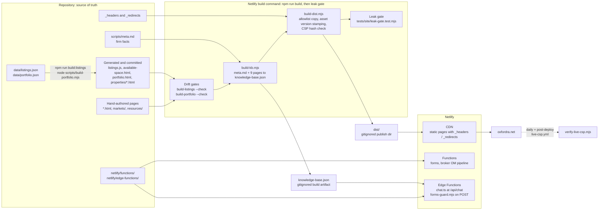
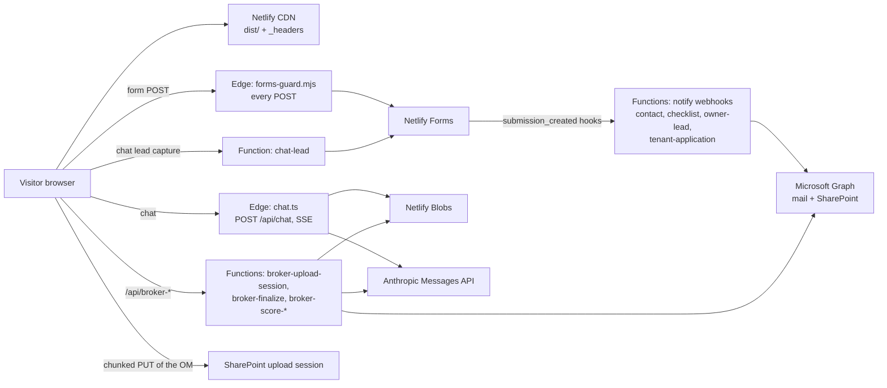

# oxfordra.net

**Source for [oxfordra.net](https://oxfordra.net), the public website of Oxford Realty Advisors, a private family-office investor in shallow-bay industrial and flex real estate.**

[](https://github.com/ZeOoba/Website/actions/workflows/ci.yml)
[](https://github.com/ZeOoba/Website/actions/workflows/live-csp.yml)
[](https://github.com/ZeOoba/Website/actions/workflows/lighthouse.yml)
[](https://github.com/ZeOoba/Website/actions/workflows/mutation.yml)

A static, multi-page HTML/CSS/JS site deployed on Netlify, with a small server side: Netlify Functions for form notifications and broker offering-memorandum (OM) intake and scoring, and two Edge Functions (the `/api/chat` assistant and an internal-forms guard). There is no framework and no page compiler. There is a build step: it checks the generated pages for drift, rebuilds the chat knowledge base, and assembles an allowlisted `dist/` that is the only thing Netlify publishes.

The site serves three audiences:

- **Tenants and prospects:** available space, tenant resources, the lease application.
- **Brokers and building owners:** deal submission, the sell-your-building flow, seller guides.
- **General diligence:** the firm, portfolio, track record, markets.

> [!WARNING]
> **Merging to `main` deploys production.** Netlify builds and publishes `main` automatically, so a merge is a production deploy and needs the site owner's explicit approval. No GitHub workflow in this repo deploys anything. Open a PR and use its deploy preview.

## Contents

- [Architecture](#architecture)
- [Page inventory](#page-inventory)
- [Repository layout](#repository-layout)
- [Local development](#local-development)
- [npm scripts](#npm-scripts)
- [Quality and verification](#quality-and-verification)
- [Data-driven pages](#data-driven-pages)
- [Functions and edge functions](#functions-and-edge-functions)
- [Security](#security)
- [Deployment](#deployment)
- [Checklists](#checklists)
- [Further documentation](#further-documentation)

## Architecture

### Build and deploy pipeline



`netlify.toml` sets `command = "npm run build && node --test tests/site/leak-gate.test.mjs"`, `publish = "dist"` and `NODE_VERSION = "20"`, so every Netlify build (previews included) runs the same drift gates, knowledge-base build, `dist/` assembly and confidential-term leak gate as CI. Any failure removes `dist/` and fails the deploy.

`scripts/build-dist.mjs` is the boundary between public content and internal tooling. Every root entry must be listed in `SITE_FILES` or `SITE_DIRS` (publish) or `EXPECTED_EXCLUSIONS` (keep private); an unclassified entry fails the build. After copying it checks that:

- no excluded or banned path (`scripts`, `evals`, `netlify`, `netlify.toml`) reached `dist/`;
- every required file is present and at least 14 root HTML pages were published;
- every same-site `.css`/`.js` reference is stamped `?v=<content hash>`;
- the inline-script hashes in `_headers` match the pages being published.

Dot-files and `*.test.js` files never ship, at any depth.

### Runtime request flow



There is no database. Durable state is Netlify Blobs (broker score results, rate-limit and daily-cap counters, replay markers, the chat limiter) plus Netlify Forms, which also serves as the failure log (`pipeline-failures` form). Server-side outbound calls go only to Microsoft Graph, the Anthropic API and Google reCAPTCHA siteverify. In the browser, analytics load through Partytown under Google Consent Mode v2 (storage denied by default, granted only on cookie-banner Accept), and the map pages load Leaflet 1.9.4 from `unpkg.com` with OpenStreetMap tiles.

## Page inventory

| Path | Purpose |
|---|---|
| `index.html` | Home: firm overview, investment criteria, featured acquisitions |
| `about.html` | Firm history, leadership, strategy |
| `portfolio.html` | Portfolio grid, market mix and JSON-LD (generated from `data/portfolio.json`) |
| `properties/*.html` | 20 per-property detail pages (generated by `scripts/build-portfolio.mjs`) |
| `track-record.html` | Case studies |
| `what-we-see.html` | How Oxford sees small industrial |
| `available-space.html` | Current availability with map, filters and inquiry form (cards and JSON-LD generated from `data/listings.json`) |
| `tenant-resources.html` | Tenant and prospect resources, leasing-inquiry form |
| `tenant-application.html`, `application-received.html` | Lease application and confirmation (both `noindex`) |
| `for-brokers.html` | Deal submission and broker OM upload |
| `sell-your-building.html` | Direct-to-owner sale process and seller FAQ |
| `resources/` | Seller guides: index plus 1031 exchange, valuation, sale-document checklist, selling without a broker |
| `markets/` | Markets index, Columbus OH, Maryland |
| `contact.html` | Contact details and form |
| `privacy.html`, `terms.html` | Privacy policy and terms of use (footer links) |
| `404.html` | Not-found page for every unmatched path (`_redirects`) |
| `broker-intake-form.html`, `broker-ledger-form.html`, `chat-lead-form.html`, `pipeline-failures-form.html` | Hidden Netlify Forms declarations: published so Netlify registers the forms, `noindex`, not linked |

Also published: `assets/` (chat widget, vendored Partytown), `images/`, `fonts/` (four self-hosted WOFF2), the two root PDFs, `sitemap.xml`, `robots.txt`, `llms.txt`, `manifest.json` and favicons.

`_redirects` carries 301s from the site's earlier Squarespace and Wix URLs, a forced 301 from every `/page.html` to its extensionless canonical, a 302 for `/owners` (direct-mail campaign link, UTM-tagged), rewrites from `/api/broker-*` to the matching function, and the `404.html` catch-all. Do not remove a legacy 301 without confirming the old path is no longer indexed.

## Repository layout

```text
.
├── *.html, *.css, *.js        Public pages, shared styles and client scripts
├── assets/ images/ fonts/     Static assets (published as-is)
├── markets/ resources/        Market pages and seller guides
├── properties/                GENERATED property pages; do not hand-edit
├── data/                      listings.json and portfolio.json, the sources for generated pages
├── netlify/
│   ├── functions/             Netlify Functions (CommonJS .js and V2 ESM .mjs)
│   │   └── _shared/           Graph auth/mail/files, reCAPTCHA, validation and tokens,
│   │                          Netlify Forms posting, broker extraction and scoring
│   └── edge-functions/        chat.ts (/api/chat) and forms-guard.mjs
├── scripts/                   Build, generators, CSP tooling, test runners, PDF builders,
│                              deploy guard, pre-push confidentiality gate, meta.md
├── tests/
│   ├── functions/             Unit tests for functions and _shared helpers
│   ├── listings/ portfolio/   Generator and content-rule tests
│   ├── client/ scripts/       Client retry logic and tooling tests
│   ├── site/                  Build-output and browser tests (CSP, SEO, forms, a11y, UI)
│   └── mutation/              Mutation harness for the site checks
├── evals/                     Chat assistant eval fixtures and dated results
├── docs/leak-gate.md          Confidential-term leak gate design
├── .github/workflows/         ci, lighthouse, live-csp, mutation
├── _headers  _redirects       Netlify headers (CSP, caching) and redirects: the source of truth
├── netlify.toml               Build command, publish dir, functions dir, edge route
└── dist/                      Build output (gitignored)
```

`README.md`, `CLAUDE.md`, `package*.json`, `data/`, `docs/`, `evals/`, `netlify/`, `scripts/` and `tests/` are all in `EXPECTED_EXCLUSIONS` and never reach `dist/`.

## Local development

### Prerequisites

| Tool | Version | Why |
|---|---|---|
| Node.js | 20 | Matches `NODE_VERSION` in `netlify.toml` and CI; `scripts/run-unit-tests.mjs` explains the Node 20 vs 21+ test-runner difference |
| npm | bundled with Node | `npm ci` against the committed lockfile |
| Playwright Chromium | via `npx playwright install chromium` | CSP, accessibility and UI tests run in a real browser |
| Python | 3.8+ | Pre-push confidentiality gate and its tests |

### Setup

```bash
npm ci                              # installs deps; postinstall wraps netlify-cli with the deploy guard
npx playwright install chromium     # one-time browser for test:site
python scripts/install_prepush_hook.py   # one-time per clone: fail-closed pre-push confidentiality gate
npm run build                       # drift gates + knowledge base + dist/
npm run serve                       # serve dist/ on http://localhost:8788 with _headers applied
```

Use `npm run serve` (`scripts/serve-dist.mjs`) for manual browser checks, not a generic static server: it applies `_headers`, so CSP problems show up locally. Run `npm run build` once before `netlify dev`, because `chat.ts` imports the generated, gitignored `netlify/edge-functions/knowledge-base.json`.

### Environment variables

Set these in the Netlify site environment. Names only; values are never committed (`.env*` is gitignored).

| Variable | Used by |
|---|---|
| `ANTHROPIC_API_KEY` | `/api/chat` and broker term extraction |
| `CHAT_MODEL`, `BROKER_SCORE_MODEL` | Optional model overrides (default in `netlify/functions/_shared/models.json`) |
| `CHAT_RATE_LIMIT_PER_10MIN` | Optional `/api/chat` per-IP limit (default 30) |
| `BROKER_UPLOAD_RATE_LIMIT_PER_10MIN` | Optional broker-upload-session per-IP limit (default 10) |
| `GRAPH_TENANT_ID`, `GRAPH_CLIENT_ID`, `GRAPH_CLIENT_SECRET`, `GRAPH_SEND_FROM` | Microsoft Graph mail and SharePoint access |
| `RECAPTCHA_SECRET_KEY` | Server-side reCAPTCHA verification (broker upload) |
| `NETLIFY_WEBHOOK_SECRET` | Signature check on the `submission_created` notify webhooks |
| `INTAKE_TOKEN_SECRET` | HMAC for broker intake tokens and signature alerts |
| `FORMS_INTERNAL_SECRET` | Internal-forms HMAC header (falls back to `INTAKE_TOKEN_SECRET`) |
| `CHAT_LEAD_FORMS_TIMEOUT_MS`, `CHAT_LEAD_GRAPH_TIMEOUT_MS`, `CHAT_LEAD_LOG_TIMEOUT_MS` | Optional chat-lead timeouts |
| `RCT_BENCHMARK_JSON`, `RCT_BENCHMARK_PIN_KEY` | Broker scoring: the RCT replacement-cost floor table and market list (governor-level; JSON, Functions scope), and the key for its HMAC pin. Missing, malformed or not the pinned table → every score is withheld as `unavailable`. See `docs/rct-benchmark-config.md` |
| `LEAK_GATE_KEY` | Only when `scripts/leak-gate-hashes.json` is generated in keyed mode (GitHub secret and Netlify build env; see `docs/leak-gate.md`) |

## npm scripts

| Script | What it does |
|---|---|
| `npm run build` | `build-listings --check` → `build-portfolio --check` → `build-kb` → `build-dist` |
| `npm run build:listings` | Regenerate `listings.js`, `available-space.html` and the portfolio availability badges from `data/listings.json` |
| `npm run serve` | Serve `dist/` on port 8788 with `_headers` applied |
| `npm run verify` | Full gate: `build` → `test:leak-gate` → `verify:jsonld` → `test:unit` → `test:site` → `test:shim` → `test:functions` (alias: `npm test`) |
| `npm run test:leak-gate` | Confidential-term leak gate over `dist/`, tracked files and PDFs |
| `npm run verify:jsonld` | Validate JSON-LD on every built page and enforce a required-page floor |
| `npm run test:unit` | Every `*.test.js` under `tests/` (except `tests/site/`) plus two co-located tests |
| `npm run test:site` | Every `tests/site/*.test.mjs` except the four with their own scripts |
| `npm run test:shim` | netlify-cli shim patch and deploy-guard tests |
| `npm run test:functions` | `chat-lead` driven over HTTP through `netlify functions:serve` |
| `npm run test:mutation` | Mutation harness (not part of `verify`) |
| `npm run leak-gate:hashes` | Regenerate the salted-hash denylist from the local roster (local only) |
| `npm run eval:chat -- --base=<url>` | Chat eval suite against a deployed origin (spends model tokens) |

Other entry points: `node scripts/build-portfolio.mjs` (regenerate portfolio pages), `node scripts/csp-hashes.mjs --write|--check`, `node scripts/verify-live-csp.mjs [url]`, `node scripts/check-form-hooks.mjs` (audits Netlify form-notification hooks; needs a netlify CLI login), `node scripts/geocode-listing.mjs "<address>"`, `node scripts/sync-listings.mjs`, and the PDF builders in `scripts/overview-pdf/` and `scripts/checklist-pdf/`.

## Quality and verification

### The gate

`npm run verify` is the pre-merge gate, and the `Build & verify` job in `.github/workflows/ci.yml` runs it on every same-repo pull request and every push to `main`. The CI job also runs `scripts/test_prepush_confidential_scan.py` (the pre-push gate's end-to-end tests) before `verify`. A red run reproduces locally with `npm run verify`.

| Stage | Proves |
|---|---|
| `build` | Generated pages match their JSON sources; knowledge base builds; `dist/` assembles with every root entry classified, assets stamped and CSP hashes current |
| `test:leak-gate` | No active confidential-deal term in `dist/`, tracked files, data, edge functions or PDFs |
| `verify:jsonld` | Every page's structured data parses and key pages still carry it |
| `test:unit` | Function, helper, generator and tooling logic (`node:test`, no framework) |
| `test:site` | Against built output in headless Chromium with `_headers` applied: CSP (smoke, every page, hash sync), SEO and entity markup, Netlify Forms declarations, consent mode, a11y, listings and map UI, asset versioning, site integrity |
| `test:shim` | The netlify-cli shim patch and deploy guard |
| `test:functions` | Runtime shape of a real function under `netlify functions:serve` (CJS vs V2) |

New `tests/site/*.test.mjs` files are picked up automatically by `scripts/run-site-tests.mjs`. `tests/scripts/test-classification.test.js` fails if a site test is run by no script, by more than one, or is listed but missing.

### CI workflows

| Workflow | Trigger | Role |
|---|---|---|
| `ci.yml` (CI) | PR, push to `main`, manual | Required `Build & verify` job; manual `eval-chat` job with an `eval_base` URL |
| `lighthouse.yml` (Lighthouse) | PR, manual | Informational (`continue-on-error`) budget on home, for-brokers, available-space, sell-your-building |
| `mutation.yml` (Mutation tests) | PRs touching the checks, manual | Breaks a copy of the site per `tests/mutation/cases.mjs` and requires the named check to fail |
| `live-csp.yml` (Live CSP) | Daily, successful production `deployment_status`, manual | Confirms the CSP the live site serves allows every inline script it serves |

Runners come from the `CI_RUNNER` repository variable (a JSON label array); unset means GitHub-hosted `ubuntu-24.04`. Fork PRs never run on a self-hosted runner. No workflow deploys.

### CSP hash workflow

`script-src` allows inline scripts by SHA-256 hash, never `'unsafe-inline'`. **After editing any inline `<script>`:**

```bash
node scripts/csp-hashes.mjs --write   # rewrite the script-src hashes in _headers
node scripts/csp-hashes.mjs --check   # exit 1 if _headers is stale
```

`npm run build` fails, and publishes nothing, when hashes and pages disagree. `<script type="text/partytown">` blocks are hashed too, because Partytown falls back to inline execution. JSON-LD blocks need no hash. Inline event handlers (`onclick=`) and `javascript:` URLs cannot be hashed and fail `tests/site/csp-all-pages.test.mjs`; use `addEventListener`. Adding a third-party origin to a page without adding it to the matching `_headers` directive fails `test:site` with the blocked URI.

After a deploy that touches a page or `_headers`, run `node scripts/verify-live-csp.mjs` (or pass a deploy-preview URL). It checks the bytes the platform actually serves, which catches post-build HTML rewrites the repo cannot see.

### Lighthouse

`scripts/lighthouse-run.mjs` runs a pinned Lighthouse against the built `dist/` (served with real headers), and `scripts/lighthouse-summary.mjs` reports against the budget: LCP ≤ 2.5 s, CLS ≤ 0.1, TBT ≤ 200 ms, every category ≥ 90. It never fails a PR.

### Chat evals

`scripts/eval-chat.mjs` runs `evals/fixtures.json` against a live `/api/chat` origin and writes dated `evals/results-*.json`. It is outside `verify` because it spends real tokens. Run it against a deploy preview, locally or via Actions → CI → Run workflow with `eval_base`.

### What CI cannot prove

- Netlify Blobs credential injection: `functions:serve` has no real Blobs store; use a deploy preview.
- Real reCAPTCHA verdicts: Google does not mint tokens for headless localhost. CI only proves the widget's origins are CSP-allowed.
- Form-notification hooks: they live in the Netlify UI. `node scripts/check-form-hooks.mjs` audits them.

## Data-driven pages

`data/listings.json` is the single source for available space. `npm run build:listings` regenerates three committed copies: the `LISTINGS` block in `listings.js`, the static fallback cards in `available-space.html` (what crawlers see without JS), and the `ItemList` JSON-LD. It also refreshes the availability badges in `portfolio.html`. Validation rejects missing fields, coordinates with fewer than 4 decimals or outside the listing's state, and unknown rate types.

`data/portfolio.json` drives `portfolio.html` (between its `portfolio:*:begin/end` markers), every `properties/*.html` page and the `sitemap.xml` `<lastmod>` stamps, via `node scripts/build-portfolio.mjs`. A property page the data no longer generates fails the build instead of being deleted.

Both generators run with `--check` inside `npm run build`, so hand edits or forgotten regenerations fail CI and the Netlify build. Supporting tools:

- `scripts/geocode-listing.mjs`: US Census geocoder lookup for a new listing (confirm the pin against parcel or aerial data).
- `scripts/sync-listings.mjs`: reconciles two agreeing LoopNet reads, supplied as JSON by an external scheduled task, against `data/listings.json`. Outcomes are noop, apply or alert (fail closed). Changes reach the site only when the resulting PR merges.
- Listing inquiry links keep a `mailto:` fallback. With JS they open a form that posts the `listing-inquiry` Netlify form, whose fields are declared in the hidden form in `available-space.html`; change both together.

## Functions and edge functions

| Source | Route / trigger | Purpose |
|---|---|---|
| `edge-functions/chat.ts` | `POST /api/chat` | Streams the assistant reply as SSE from the Anthropic Messages API; system prompt plus knowledge base, prompt-cached |
| `edge-functions/forms-guard.mjs` | Every `POST` except `/.netlify/*`, `/api/chat` and `/api/broker-*` | Returns 403 for unsigned POSTs to the internal forms (`broker-network-ledger`, `pipeline-failures`) |
| `functions/chat-lead.js` | `/.netlify/functions/chat-lead` | Writes chat leads to the `chat-lead` form; falls back to Graph email plus a `pipeline-failures` row |
| `functions/broker-upload-session.js` | `/api/broker-upload-session` | Honeypot, file checks, reCAPTCHA, per-IP limit; mints a SharePoint upload session and a signed intake token |
| `functions/broker-finalize.mjs` | `/api/broker-finalize` | Verifies the token and the uploaded file, logs the submission, then starts scoring subject to a per-IP limit and a global daily cap |
| `functions/broker-score-background.mjs` | Background function | Reads the OM (xlsx/xls, docx, PDF), extracts deal terms with the LLM, scores against the buy-box, stores the result in Blobs |
| `functions/broker-score-status.mjs` | `/api/broker-score-status` | Polled by `broker-upload.js` for the score result |
| `functions/contact-notify.js`, `checklist-notify.js`, `owner-lead-notify.js`, `tenant-application-processor.js` | `submission_created` URL hooks set in the Netlify UI | Verify the webhook signature, gate on `form_name`, notify via Graph |
| `functions/signature-alert.mjs` | Called by the notify functions | Throttled alert (one per UTC hour) when a webhook signature is rejected |

Functions that use Netlify Blobs are V2 ESM (`.mjs`) and must not export `handler`; `tests/functions/broker-v2-runtime-contract.test.js` and `esm-cjs-bundling-contract.test.js` enforce it. The Anthropic model id lives in one place, `netlify/functions/_shared/models.json`.

## Security

**Content Security Policy** (`_headers`, applied to every path):

- `default-src 'self'`; `script-src` lists a hash per distinct inline script plus exact third-party URLs (Google Tag Manager, reCAPTCHA, the pinned Leaflet file on unpkg, Netlify RUM).
- `style-src` keeps `'unsafe-inline'` on purpose: the markup carries hundreds of `style=""` attributes, and CSS injection is a much smaller risk than script injection.
- `connect-src` is limited to analytics, reCAPTCHA, OpenStreetMap tiles, the firm's SharePoint host (direct OM upload) and Netlify RUM.
- `object-src 'none'`, `base-uri 'self'`, `form-action 'self'`, `frame-ancestors 'none'`.

**Other headers:** `X-Frame-Options: DENY`, `X-Content-Type-Options: nosniff`, `Referrer-Policy: strict-origin-when-cross-origin`, a `Permissions-Policy` that disables camera, microphone and geolocation, and HSTS with `preload`. Images, fonts, CSS and JS are cached for one year as `immutable`. That is safe because `build-dist.mjs` content-hashes every local asset URL. HTML is `must-revalidate`, and PDFs are cached for one day. `/` preloads the four webfonts and the hero image.

**Server-side controls:**

- Notify webhooks verify Netlify's signed `x-webhook-signature` (with `NETLIFY_WEBHOOK_SECRET`, failing closed when unset).
- Broker intake uses HMAC-signed, expiring, typed tokens, reCAPTCHA, a honeypot, per-IP limits and a Blobs-backed daily cap on paid scoring.
- `/api/chat` validates message shape and size, applies an in-memory and a Blobs-backed per-IP limit, bounds the upstream wait, cancels the upstream stream on error, and reflects only its own origins in CORS.
- The chat proxy redacts the API key from anything it logs.

**Confidentiality gates:** this repository is public, so it is treated as an external surface.

- `tests/site/leak-gate.test.mjs` scans `dist/`, every tracked file and both PDFs against a salted-hash denylist and fails CI and every Netlify build on a hit. See [`docs/leak-gate.md`](docs/leak-gate.md).
- `scripts/prepush_confidential_scan.py` is a fail-closed git pre-push hook. It scans commits, diffs, blobs and ref names in a push against the machine-local roster and never prints a term. Install it once per clone with `python scripts/install_prepush_hook.py` (shim: `scripts/git-hooks/pre-push`).

**Deploy guard:** the `postinstall` step (`scripts/patch-netlify-shim.js`) puts `scripts/netlify-guard.js` in front of the local netlify-cli binary, so production CLI deploys need a valid authorization token even when the command is indirected.

## Deployment

| | Preview | Production |
|---|---|---|
| Trigger | Every PR (Netlify deploy preview), or `netlify deploy --build` from a checkout | Merge to `main` (Netlify auto-build), or an authorized CLI production deploy |
| Approval | None | **Explicit approval from the site owner for each deploy** |
| Build | `npm run build` + leak gate, as in `netlify.toml` | Same |
| Follow-up | Review the preview; optionally `node scripts/verify-live-csp.mjs <preview-url>` or the chat eval | Live CSP workflow (daily and post-deploy); `node scripts/verify-live-csp.mjs` by hand |

Rules:

- **Merging a PR to `main` is a production deploy.** Do not merge without the owner's approval.
- Never run `netlify deploy --dir=.`, because that publishes the repo root, internal tooling included. Deploy with `--build` so `dist/` is rebuilt.
- `_headers` and `_redirects` are the source of truth. Do not duplicate them in `netlify.toml`.
- A Netlify dashboard setting that rewrites HTML (snippet injection, asset optimization) changes inline-script bytes and is blocked by the CSP. The Live CSP workflow catches this.

## Checklists

### Adding a page

1. Create the HTML (root, or `markets/`, `resources/`). Copy the head, nav, footer and consent-mode script from a sibling page.
2. Root page only: add it to `SITE_FILES` in `scripts/build-dist.mjs` (directories in `SITE_DIRS` publish automatically).
3. Add a forced 301 from `/<page>.html` to `/<page>` in `_redirects` and a `<loc>` in `sitemap.xml`. `tests/site/seo.test.mjs` keeps these in sync.
4. Add the canonical link, meta description and JSON-LD where the page warrants it.
5. If the page has any new or changed inline `<script>`, run `node scripts/csp-hashes.mjs --write`.
6. If the chat assistant should know the page, add it to the page list in `scripts/build-kb.mjs`. Update `llms.txt` if it belongs in the key-pages list.
7. Run `npm run verify`.

### Adding a root file

Classify it in `scripts/build-dist.mjs`: `SITE_FILES` to publish, or `EXPECTED_EXCLUSIONS` to keep private. An entry in neither list, or in both, fails the build. Dot-prefixed names are always private.

### Adding a form or notify function

- Every lead form needs the hidden `lead-landing` and `lead-referrer` inputs, declared in its Netlify form (`tests/site/lead-source.test.mjs`).
- Netlify drops undeclared fields, so keep the hidden form declaration and the live form in sync.
- A notify function runs only when a form-notification hook in the Netlify UI points at it. After any change, run `node scripts/check-form-hooks.mjs`.

### Adding a third-party origin

Add the exact origin or URL to the narrowest matching `_headers` directive and run `npm run test:site`. The CSP tests name the blocked URI and directive.

## Further documentation

- [`docs/leak-gate.md`](docs/leak-gate.md): leak gate design, matching rules, keyed mode, residual risk.
- [`CLAUDE.md`](CLAUDE.md): short rules for AI coding agents working in this repo.
- [`scripts/meta.md`](scripts/meta.md): canonical firm facts for the chat knowledge base. Edit it, not individual pages, when firm-level facts change.
- [`netlify.toml`](netlify.toml), [`_headers`](_headers), [`_redirects`](_redirects), [`scripts/build-dist.mjs`](scripts/build-dist.mjs): build, headers, redirects and publish boundary.
- [`tests/mutation/cases.mjs`](tests/mutation/cases.mjs): which breakage each site check must catch.
