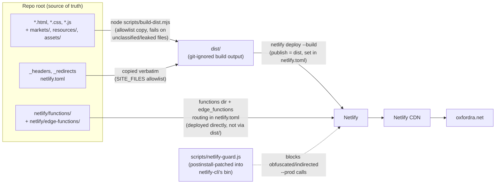
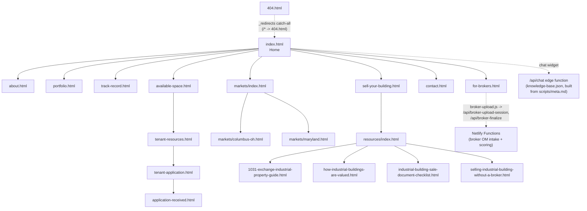

# oxfordra.net — Oxford Realty Advisors Website

Source repository for [oxfordra.net](https://oxfordra.net), the public marketing website for Oxford Realty Advisors (ORA), a private family-office industrial real estate investor. The site serves three audiences — industrial tenants and prospects looking for space (`available-space`, `tenant-resources`, `tenant-application`), brokers and building owners with deals to sell (`for-brokers`, `sell-your-building`, `resources/`), and general firm diligence (`about`, `portfolio`, `track-record`). It is a static multi-page HTML/CSS/JS site with a handful of Netlify Functions (form intake, broker OM scoring) and an edge-function-backed chat assistant, deployed to Netlify.

## Architecture

### Build & deploy flow



The repo root deliberately mixes **public site content** with **internal tooling** (scripts, tests, evals, function source). `scripts/build-dist.mjs` is the boundary: it enumerates every root entry one-by-one into either a publish allowlist (`SITE_FILES`/`SITE_DIRS`) or an explicit exclusion list, and **fails the build** on anything unclassified — a new file can neither silently ship nor silently vanish. `netlify.toml` sets `publish = "dist"` and `command = "node scripts/build-dist.mjs"`, so a merged PR to `main` rebuilds `dist/` from source before Netlify serves it.

### Site content structure



`_redirects` also 301s a set of legacy Squarespace and Wix paths (e.g. `/team`, `/investments`, `/portfolio-1`) onto the current pages shown above — do not remove those without confirming the old paths are no longer indexed.

## Repo layout

```
├── *.html                    Public pages (index, about, portfolio, contact, ...)
├── *.css / *.js               Shared styles and client-side scripts
├── assets/, images/, fonts/   Static site assets (copied verbatim to dist/)
├── markets/                   Per-market landing pages (Columbus OH, Maryland)
├── resources/                 Seller-focused guide pages (1031 exchange, valuation, ...)
├── netlify/
│   ├── functions/             Netlify Functions (forms, broker OM intake, lead notify)
│   │   └── _shared/           Shared helpers (Graph API auth/mail/files, validation, scoring)
│   └── edge-functions/        Edge function for the /api/chat assistant + its knowledge base
├── scripts/
│   ├── build-dist.mjs         Assembles dist/ for deploy (see above)
│   ├── build-kb.mjs           Builds the chat assistant's knowledge base
│   ├── eval-chat.mjs          Runs the chat assistant eval suite (see evals/)
│   ├── validate-jsonld.js     Validates JSON-LD structured data on site pages
│   ├── netlify-guard.js       Blocks indirected/obfuscated `netlify deploy --prod` calls
│   ├── patch-netlify-shim.js  postinstall hook wiring netlify-guard.js into netlify-cli's bin
│   └── meta.md                Canonical firm facts fed into the chat assistant's knowledge base
├── tests/functions/            node:test unit tests for netlify/functions/
├── evals/                      Chat assistant eval fixtures + dated result runs
├── dist/                       BUILD OUTPUT — git-ignored, assembled by build-dist.mjs
├── _headers                    Netlify response headers (CSP, caching, HSTS, preloads)
├── _redirects                  Netlify redirects (legacy Squarespace/Wix paths, non-www enforcement)
├── netlify.toml                Netlify build/publish/functions/edge-function config
├── sitemap.xml, robots.txt, llms.txt   Search + LLM-crawler discovery files
└── docs/superpowers/            Session-local planning artifacts — git-ignored, not site content
```

## Local development

Per `package.json`, the only defined script is `postinstall`; there is no site build step beyond assembling `dist/` — pages are hand-authored static HTML.

```bash
npm install                    # installs netlify-cli (pinned v26.2.0) + deps;
                                # postinstall runs scripts/patch-netlify-shim.js,
                                # which wires netlify-guard.js into netlify-cli's bin
node scripts/build-dist.mjs    # assemble dist/ locally to inspect exactly what would ship
```

`npm install` pins `netlify-cli` to a tested version so deploys resolve a local install rather than depending on `npx`'s evictable cache.

**Deploys to production require separate, explicit permission** — this is a standing rule for this repo (Hard Invariant 2). Editing `README.md` or any other file here does not deploy anything by itself; `dist/` and the live site are only touched by an explicit, confirmed `netlify deploy` invocation.

## Testing

Unit tests for the Netlify Functions live in `tests/functions/` and use Node's built-in test runner (`node:test`, no framework dependency):

```bash
node --test tests/functions/
```

`application-script.file-size.test.js` at the repo root guards the size of the hand-written DOM script rather than testing exports (it has none — it's a DOM IIFE).

The chat assistant has a separate eval harness (`scripts/eval-chat.mjs` against fixtures in `evals/fixtures.json`), with dated result snapshots retained in `evals/`.

## Key pages

| Page | Purpose |
|---|---|
| `index.html` | Home — firm overview, investment criteria, featured acquisitions |
| `about.html` | Firm history, leadership, investment strategy |
| `portfolio.html` | Owned industrial/flex property portfolio |
| `track-record.html` | Case studies and investment performance |
| `available-space.html` | Current industrial/flex leasing availability |
| `tenant-resources.html` | Resources for current and prospective tenants |
| `tenant-application.html` / `application-received.html` | Tenant lease application form + confirmation |
| `for-brokers.html` | Deal submission, investment criteria, broker incentives |
| `sell-your-building.html` | Direct-to-owner sale process, all-cash offer terms, seller FAQ |
| `resources/index.html` + 4 guide pages | Seller guides — 1031 exchange, valuation, sale-document checklist, selling without a broker |
| `markets/index.html`, `markets/columbus-oh.html`, `markets/maryland.html` | Core-market overview + per-market portfolio/market data |
| `contact.html` | Contact information |
| `privacy.html`, `terms.html` | Privacy policy, terms of use |
| `404.html` | Not-found page, served for all unmatched paths via `_redirects` |
| `broker-intake-form.html`, `broker-ledger-form.html`, `chat-lead-form.html`, `pipeline-failures-form.html` | Internal-only form pages (titled "(internal)"), still published — not linked from site nav |

## Netlify Functions

| Function | Purpose |
|---|---|
| `chat-lead.js` | Captures leads submitted via the chat assistant |
| `broker-upload-session.js` / `broker-finalize.js` | Broker OM (offering memorandum) upload intake pipeline |
| `broker-score-background.js` / `broker-score-status.js` | Async scoring of submitted broker deals against ORA's buy-box |
| `owner-lead-notify.js` | Notifies on direct-to-owner ("sell your building") lead submissions |
| `tenant-application-processor.js` | Processes tenant lease applications |
| `edge-functions/chat.ts` | Edge function powering the `/api/chat` assistant, backed by `edge-functions/knowledge-base.json` (built by `scripts/build-kb.mjs` from `scripts/meta.md` + site content) |

Shared helpers (Microsoft Graph auth/mail/file access, reCAPTCHA verification, form validation, broker-score engine) live in `netlify/functions/_shared/`.

## Headers & CSP

`_headers` (source of truth, not duplicated in `netlify.toml`) sets, for all paths:

- `Content-Security-Policy` — `default-src 'self'`, with explicit allowances for Google Tag Manager, LinkedIn Insight (`snap.licdn.com`), Google reCAPTCHA, `unpkg.com` (scripts + styles), Netlify RUM, Google Analytics/`doubleclick.net`, OpenStreetMap tiles, and the firm's SharePoint domain (`oxfordraeg.sharepoint.com`) for `connect-src`.
- `X-Frame-Options: DENY`, `X-Content-Type-Options: nosniff`, `Referrer-Policy: strict-origin-when-cross-origin`, `Permissions-Policy` (camera/microphone/geolocation all disabled), and HSTS with `preload`.
- Long-lived immutable caching (`max-age=31536000`) for `/images/*`, `/fonts/*`, `*.css`, `*.js`; `must-revalidate` for `*.html`; 1-day caching for `*.pdf`.
- Font and hero-image `Link: rel=preload` hints on `/` and `/index.html` (four self-hosted webfonts + the homepage hero image, `fetchpriority=high`).

## Content notes

- `scripts/meta.md` holds canonical firm facts (leadership, markets, deal parameters, contact info) that feed the chat assistant's knowledge base — update it, not individual pages, when firm-level facts change.
- `_redirects` carries permanent 301s from the site's prior Squarespace and Wix incarnations; do not remove these without confirming the old paths are no longer indexed.
- `llms.txt` is a machine-readable summary for LLM crawlers — keep its key-pages list in sync with actual site navigation.

## Related

- `.claude/` — machine-local Claude Code tooling config (`launch.json` is git-ignored; not part of the deployed site)
- `docs/superpowers/` — session planning artifacts, git-ignored, not site content
