# AI Visibility Improvements Implementation Plan

> **For agentic workers:** REQUIRED SUB-SKILL: Use superpowers:subagent-driven-development (recommended) or superpowers:executing-plans to implement this plan task-by-task. Steps use checkbox (`- [ ]`) syntax for tracking.

**Goal:** Close the three highest-leverage AI/search visibility gaps identified in the 2026-07-10 audit — invisible available-space listings, missing entity/redirect signals, and zero market-specific content — so oxfordra.net surfaces when brokers or AI assistants ask about warehouse space or industrial buyers in Oxford's target markets.

**Architecture:** oxfordra.net is a hand-authored static HTML/CSS/JS site. As of PR #10/#11 (merged to main 2026-07-10, same day as this plan), the repo root mixes public site files with internal tooling (`scripts/`, `evals/`, `netlify/` source), and `netlify.toml`'s `[build] command` runs `node scripts/build-dist.mjs` to assemble an explicit allowlisted copy into `dist/`, which is what Netlify actually publishes — `netlify.toml`'s old `publish = "."` is gone. There is no bundler, no template engine, no test framework beyond that allowlist script. Every page repeats the same head boilerplate, critical-CSS block, nav, and footer inline. Changes in this plan follow that existing convention exactly — no framework is introduced, and any new top-level file or directory must be explicitly classified in `scripts/build-dist.mjs`'s `SITE_FILES`/`SITE_DIRS`/`EXPECTED_EXCLUSIONS` or the build fails closed.

**Tech Stack:** Static HTML/CSS/vanilla JS, Netlify (redirects via `_redirects`, headers via `_headers`, functions/edge-functions and the `dist/` build command via `netlify.toml`), Node v24 (runs both `scripts/build-dist.mjs` and this plan's verification script), Python 3 (used only to serve local preview).

## Global Constraints

- Real build step: `node scripts/build-dist.mjs` assembles `dist/` from an explicit allowlist (`SITE_FILES` for root files, `SITE_DIRS` for recursively-copied directories, `EXPECTED_EXCLUSIONS` for root entries that must stay private). Every root-level entry must be classified or the build exits 1 — dot-prefixed entries (`.claude/`, etc.) are always private and need no classification. Any new top-level file/directory this plan adds must be added to the correct list.
- This branch starts from a cherry-pick of commit `0662480` (`fix: classify package.json/package-lock.json/node_modules in build-dist`, from the not-yet-merged `fix/build-dist-classify-package-files`) — without it, `node scripts/build-dist.mjs` fails on unclassified `package.json`/`package-lock.json`/`node_modules` regardless of anything in this plan (confirmed: main has been deploy-broken since PR #11 merged). Do not re-solve that classification independently — it's already handled by the cherry-pick.
- No test framework exists. Verification = (a) `scripts/validate-jsonld.js` (JSON-LD parses), (b) grep-based content assertions, (c) manual browser check via a local static server.
- Redirects and headers live in `_redirects` / `_headers` only. `netlify.toml` line 1-3 explicitly states these are "the source of truth" and must not be duplicated there.
- Never fabricate firm, property, or market data. Every fact used in new copy or schema must trace to content already published elsewhere on the site (`portfolio.html`, `for-brokers.html`, `listings.js`, `index.html`).
- Preserve existing JS interactivity exactly. `listings.js`'s `renderCards()` overwrites `#listingsPanel` entirely on `DOMContentLoaded` (confirmed at `listings.js:458-460`) — static HTML added for crawler visibility must not conflict with or degrade that behavior.
- Match established page conventions exactly: shared head boilerplate (meta/OG/Twitter/favicons/font-preloads), the `.subpage-hero` pattern (established in `for-brokers.html`) for content-page heroes, the `BreadcrumbList` + `FAQPage` JSON-LD pattern (established in `for-brokers.html`), and the `.portfolio-card` / `.market-card` classes already defined in the shared `styles.css` — no new CSS framework or component system.
- Never push to `main` or trigger a production deploy of oxfordra.net without Gabriel's explicit in-turn confirmation. A Netlify preview/draft deploy is the default and does not require additional confirmation; production does.

**Erratum (caught during Task 4 review, corrected in the shipped page — not in this plan text below):** Task 4's Step 2 HTML and the two `.criteria-list` references above were based on a misread `grep -l` result during research (a multi-pattern OR search in files-only mode, which confirms *some* pattern matched a file, not *which* one) — `.criteria-list`/`.criteria-list__item`/`.criteria-list__key`/`.criteria-list__value` do not actually exist in `styles.css`. The real, working, already-established pattern for this component is `.criteria-grid`/`.criteria-row`/`.criteria-label`/`.criteria-value` (used by `for-brokers.html`). The Task 4 implementation was corrected to use the real classes post-review; the HTML block further down in this document still shows the original (broken) markup as a historical record of what was drafted, not what shipped.

**Out of scope:** the 2026-07-10 audit's priority list had six items. Items 1-3 (available-space crawler visibility, entity/redirect fixes, Columbus market page) are Tasks 2-4 below. Items 4-6 — a county-parcel-derived market data brief, a manual LoopNet company-profile update, and press placements — are content/editorial/external-platform work with no code deliverable and no meaningful test cycle, so they're excluded from this engineering plan and left as follow-up work.

---

### Task 1: Verification tooling — JSON-LD validator + local preview server

**Files:**
- Create: `scripts/validate-jsonld.js`
- Create: `.claude/launch.json`
- Modify: `scripts/build-dist.mjs` (classify one new top-level name this plan introduces)

**Interfaces:**
- Produces: `node scripts/validate-jsonld.js <path/to/file.html>` — exits 0 and prints one `OK — <@type>` line per JSON-LD block if all blocks parse as valid JSON; exits 1 and prints `INVALID JSON — <error>` for any block that doesn't. Used by every later task to check JSON-LD before committing.
- Produces: a `static-preview` launch config serving the repo root at `http://localhost:8899`, used by every later task for browser verification via the Claude_Browser preview tools.
- Produces: `scripts/build-dist.mjs` classifies `docs` (this plan's own home directory) as private, so `node scripts/build-dist.mjs` keeps exiting 0 throughout this plan's execution instead of failing closed on an unclassified root entry. `markets` is deliberately NOT classified here — `build-dist.mjs`'s "SITE_DIRS must be non-empty in dist/" check runs unconditionally for every SITE_DIRS entry, so classifying an empty `markets/` early would force a throwaway placeholder file that ships to production. Task 4 classifies `markets` itself, right after creating real content there.

- [ ] **Step 1: Write the JSON-LD validator script**

```javascript
#!/usr/bin/env node
'use strict';
const fs = require('fs');

const file = process.argv[2];
if (!file) {
  console.error('Usage: node scripts/validate-jsonld.js <path/to/file.html>');
  process.exit(1);
}

const html = fs.readFileSync(file, 'utf8');
const blocks = [...html.matchAll(/<script type="application\/ld\+json"[^>]*>([\s\S]*?)<\/script>/g)];

if (blocks.length === 0) {
  console.error('No JSON-LD blocks found in ' + file);
  process.exit(1);
}

let failed = false;
blocks.forEach(function (match, i) {
  const raw = match[1].trim();
  try {
    const parsed = JSON.parse(raw);
    const type = parsed['@type'] || '(no @type)';
    console.log('[' + (i + 1) + '/' + blocks.length + '] OK — ' + type + ' — ' + file);
  } catch (err) {
    failed = true;
    console.error('[' + (i + 1) + '/' + blocks.length + '] INVALID JSON — ' + err.message + ' — ' + file);
  }
});

process.exit(failed ? 1 : 0);
```

- [ ] **Step 2: Prove the validator catches invalid JSON**

Run:
```bash
mkdir -p /tmp/jsonld-check && printf '<script type="application/ld+json">{"@type":"Thing", bad}</script>' > /tmp/jsonld-check/bad.html
node scripts/validate-jsonld.js /tmp/jsonld-check/bad.html
echo "exit code: $?"
```
Expected: prints `INVALID JSON — ...` and `exit code: 1`.

- [ ] **Step 3: Prove the validator passes on a known-good real file**

Run: `node scripts/validate-jsonld.js about.html`
Expected: two lines, `[1/2] OK — BreadcrumbList — about.html` and `[2/2] OK — Organization — about.html`, exit code 0.

- [ ] **Step 4: Create the local preview server config**

```json
{
  "version": "0.0.1",
  "configurations": [
    {
      "name": "static-preview",
      "runtimeExecutable": "python",
      "runtimeArgs": ["-m", "http.server", "8899"],
      "port": 8899
    }
  ]
}
```

Write this to `.claude/launch.json`. If the file already exists with other configurations, add this object to the existing `configurations` array instead of overwriting the file.

- [ ] **Step 5: Start the preview server and confirm it serves the current site**

Use the `preview_start` tool with `name: "static-preview"`, then `preview_screenshot` or `preview_snapshot` against `http://localhost:8899/`. Expected: the current homepage renders (hero "Private Capital for Industrial Real Estate" visible).

- [ ] **Step 6: Classify this plan's own directory in the dist allowlist**

`scripts/build-dist.mjs` fails the build closed on any unclassified top-level entry (dot-prefixed entries like `.claude/` are exempt automatically). This plan's home directory, `docs/`, is a top-level name the current allowlist doesn't know about, and must stay private — same as `scripts/` and `evals/`. (`markets/`, Task 4's new page directory, is deliberately classified in Task 4 instead of here — see that task's Interfaces note.)

In `scripts/build-dist.mjs`, change:

```javascript
const EXPECTED_EXCLUSIONS = ['evals', 'netlify', 'netlify.toml', 'node_modules', 'package-lock.json', 'package.json', 'scripts'];
```

to:

```javascript
const EXPECTED_EXCLUSIONS = ['docs', 'evals', 'netlify', 'netlify.toml', 'node_modules', 'package-lock.json', 'package.json', 'scripts'];
```

- [ ] **Step 7: Verify the build still passes**

Run: `node scripts/build-dist.mjs`
Expected: exits 0. Output includes `docs/` (or `docs` if the plan file isn't present in this checkout) in the "excluded (never deployed)" line.

- [ ] **Step 8: Commit**

```bash
git add scripts/validate-jsonld.js scripts/build-dist.mjs .claude/launch.json
git commit -m "chore: add JSON-LD validator, local preview server config, and dist-allowlist entries for markets/ and docs/"
```

---

### Task 2: Make available-space listings crawler-visible

**Context:** `available-space.html`'s `#listingsPanel` div is empty except for a hidden "no results" message, and `#listing-schema` is an empty `{}` JSON-LD block. All six current listings live only in the `LISTINGS` array in `listings.js:10-68` and are injected via `innerHTML` after `DOMContentLoaded` (`listings.js:458-460`). Non-JS crawlers (GPTBot, ClaudeBot, PerplexityBot, Google-Extended) never see this content. This task adds the same content as static HTML so it's present in the raw response, while leaving the JS-driven interactive behavior untouched (JS still overwrites the panel on load — confirmed no other code reads the panel's initial content before that overwrite).

**Files:**
- Modify: `available-space.html:235-240` (the `#listingsPanel` div)
- Modify: `available-space.html:254` (the `#listing-schema` script block)
- Modify: `listings.js:9` (add a maintenance-note comment above `LISTINGS`)

**Interfaces:**
- Consumes: `scripts/validate-jsonld.js` from Task 1.
- Produces: no new functions or exports — this task only changes static markup and JSON-LD content that later tasks don't depend on.

- [ ] **Step 1: Verify the current gap**

Run: `grep -c 'as-card"' available-space.html`
Expected: `0` (no listing cards exist in the raw HTML).

Run: `grep -o '"listing-schema">{}' available-space.html`
Expected: prints the match — confirms the schema block is empty.

- [ ] **Step 2: Replace the empty listings panel with static-rendered cards**

In `available-space.html`, replace:

```html
      <div class="as-listings" id="listingsPanel">
        <div class="as-no-results" id="noResults" style="display:none;">
          <p>No listings match your filters. Try adjusting your search criteria.</p>
        </div>
      </div>
```

with:

```html
      <div class="as-listings" id="listingsPanel">
        <article class="as-card" data-id="1">
          <div class="as-card__img">
            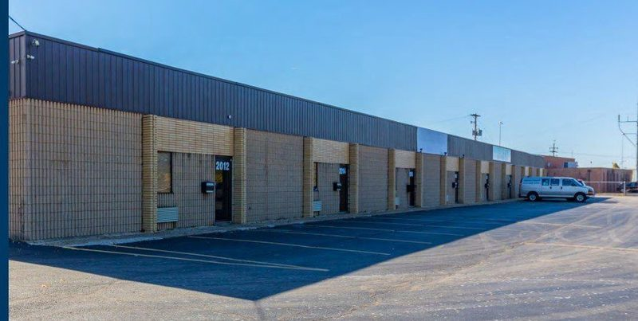
            <span class="as-card__badge as-card__badge--available">1 Space</span>
          </div>
          <div class="as-card__body">
            <h2 class="as-card__title">2012-2026 Zettler Rd</h2>
            <div class="as-card__address">
              <svg width="12" height="12" viewBox="0 0 24 24" fill="none" stroke="currentColor" stroke-width="2" aria-hidden="true"><path d="M21 10c0 7-9 13-9 13S3 17 3 10a9 9 0 0 1 18 0z"/><circle cx="12" cy="10" r="3"/></svg>
              Columbus, OH
            </div>
            <div class="as-card__stats">
              <span class="as-card__stat">1,800 SF total</span>
              <span class="as-card__stat">Flex</span>
              <span class="as-card__stat">Columbus</span>
            </div>
            <div class="as-card__single-unit">
              <div class="as-unit-inline">
                <div><span class="as-unit__label">Suite</span> 2016</div>
                <div><span class="as-unit__label">Size</span> 1,800 SF</div>
                <div><span class="as-unit__label">Asking</span> $11.67 <span class="as-unit__rate-type">MG</span></div>
              </div>
            </div>
            <div class="as-card__footer">
              <a href="mailto:info@oxfordra.net?subject=Inquiry%20-%202012-2026%20Zettler%20Rd" class="as-card__cta" aria-label="Inquire about 2012-2026 Zettler Rd">Inquire</a>
              <a href="tel:+13015126125" class="as-card__phone" title="Call 301.512.6125">
                <svg width="14" height="14" viewBox="0 0 24 24" fill="none" stroke="currentColor" stroke-width="2" aria-hidden="true"><path d="M22 16.92v3a2 2 0 01-2.18 2 19.79 19.79 0 01-8.63-3.07 19.5 19.5 0 01-6-6A19.79 19.79 0 012.12 4.18 2 2 0 014.11 2h3a2 2 0 012 1.72c.127.96.362 1.903.7 2.81a2 2 0 01-.45 2.11L8.09 9.91a16 16 0 006 6l1.27-1.27a2 2 0 012.11-.45c.907.338 1.85.573 2.81.7A2 2 0 0122 16.92z"/></svg>
              </a>
            </div>
          </div>
        </article>
        <article class="as-card" data-id="2">
          <div class="as-card__img">
            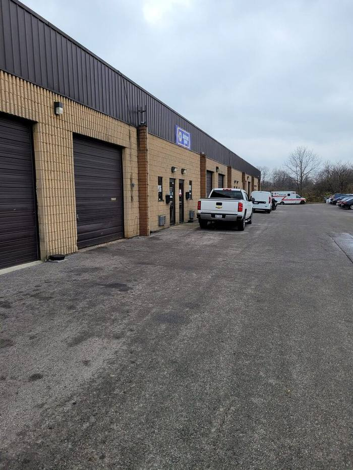
            <span class="as-card__badge as-card__badge--available">1 Space</span>
          </div>
          <div class="as-card__body">
            <h2 class="as-card__title">384-398 Morrison Rd</h2>
            <div class="as-card__address">
              <svg width="12" height="12" viewBox="0 0 24 24" fill="none" stroke="currentColor" stroke-width="2" aria-hidden="true"><path d="M21 10c0 7-9 13-9 13S3 17 3 10a9 9 0 0 1 18 0z"/><circle cx="12" cy="10" r="3"/></svg>
              Columbus, OH
            </div>
            <div class="as-card__stats">
              <span class="as-card__stat">1,800 SF total</span>
              <span class="as-card__stat">Flex</span>
              <span class="as-card__stat">Columbus</span>
            </div>
            <div class="as-card__single-unit">
              <div class="as-unit-inline">
                <div><span class="as-unit__label">Suite</span> 390</div>
                <div><span class="as-unit__label">Size</span> 1,800 SF</div>
                <div><span class="as-unit__label">Asking</span> $13.33 <span class="as-unit__rate-type">MG</span></div>
              </div>
            </div>
            <div class="as-card__footer">
              <a href="mailto:info@oxfordra.net?subject=Inquiry%20-%20384-398%20Morrison%20Rd" class="as-card__cta" aria-label="Inquire about 384-398 Morrison Rd">Inquire</a>
              <a href="tel:+13015126125" class="as-card__phone" title="Call 301.512.6125">
                <svg width="14" height="14" viewBox="0 0 24 24" fill="none" stroke="currentColor" stroke-width="2" aria-hidden="true"><path d="M22 16.92v3a2 2 0 01-2.18 2 19.79 19.79 0 01-8.63-3.07 19.5 19.5 0 01-6-6A19.79 19.79 0 012.12 4.18 2 2 0 014.11 2h3a2 2 0 012 1.72c.127.96.362 1.903.7 2.81a2 2 0 01-.45 2.11L8.09 9.91a16 16 0 006 6l1.27-1.27a2 2 0 012.11-.45c.907.338 1.85.573 2.81.7A2 2 0 0122 16.92z"/></svg>
              </a>
            </div>
          </div>
        </article>
        <article class="as-card" data-id="3">
          <div class="as-card__img">
            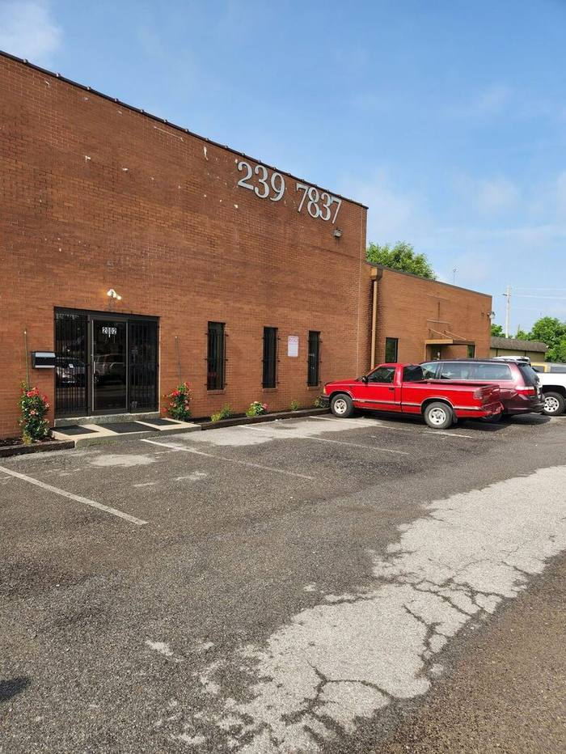
            <span class="as-card__badge as-card__badge--available">2 Spaces</span>
          </div>
          <div class="as-card__body">
            <h2 class="as-card__title">2000-2002 Zettler Rd</h2>
            <div class="as-card__address">
              <svg width="12" height="12" viewBox="0 0 24 24" fill="none" stroke="currentColor" stroke-width="2" aria-hidden="true"><path d="M21 10c0 7-9 13-9 13S3 17 3 10a9 9 0 0 1 18 0z"/><circle cx="12" cy="10" r="3"/></svg>
              Columbus, OH
            </div>
            <div class="as-card__stats">
              <span class="as-card__stat">11,160 SF total</span>
              <span class="as-card__stat">Industrial</span>
              <span class="as-card__stat">Columbus</span>
            </div>
            <button class="as-card__expand" data-id="3" aria-expanded="false">
              <span>View 2 Available Spaces</span>
              <svg width="12" height="12" viewBox="0 0 12 12" fill="none" stroke="currentColor" stroke-width="1.5" aria-hidden="true"><path d="M3 4.5L6 7.5L9 4.5"/></svg>
            </button>
            <div class="as-card__units">
              <div class="as-unit" data-pid="3" data-suite="2000">
                <div class="as-unit__suite"><span class="as-unit__label">Suite</span>2000</div>
                <div class="as-unit__sf"><span class="as-unit__label">Size</span>4,960 SF</div>
                <div class="as-unit__use"><span class="as-unit__label">Use</span>Industrial</div>
                <div class="as-unit__rate"><span class="as-unit__label">Asking</span>$8.00 <span class="as-unit__rate-type">NNN</span></div>
                <a href="mailto:info@oxfordra.net?subject=Inquiry%20-%202000-2002%20Zettler%20Rd%20Suite%202000" class="as-unit__inquire" aria-label="Inquire about Suite 2000 at 2000-2002 Zettler Rd">Inquire</a>
              </div>
              <div class="as-unit" data-pid="3" data-suite="2002">
                <div class="as-unit__suite"><span class="as-unit__label">Suite</span>2002</div>
                <div class="as-unit__sf"><span class="as-unit__label">Size</span>6,200 SF</div>
                <div class="as-unit__use"><span class="as-unit__label">Use</span>Industrial</div>
                <div class="as-unit__rate"><span class="as-unit__label">Asking</span>$8.00 <span class="as-unit__rate-type">NNN</span></div>
                <a href="mailto:info@oxfordra.net?subject=Inquiry%20-%202000-2002%20Zettler%20Rd%20Suite%202002" class="as-unit__inquire" aria-label="Inquire about Suite 2002 at 2000-2002 Zettler Rd">Inquire</a>
              </div>
            </div>
            <div class="as-card__footer">
              <a href="mailto:info@oxfordra.net?subject=Inquiry%20-%202000-2002%20Zettler%20Rd" class="as-card__cta" aria-label="Inquire about 2000-2002 Zettler Rd">Inquire</a>
              <a href="tel:+13015126125" class="as-card__phone" title="Call 301.512.6125">
                <svg width="14" height="14" viewBox="0 0 24 24" fill="none" stroke="currentColor" stroke-width="2" aria-hidden="true"><path d="M22 16.92v3a2 2 0 01-2.18 2 19.79 19.79 0 01-8.63-3.07 19.5 19.5 0 01-6-6A19.79 19.79 0 012.12 4.18 2 2 0 014.11 2h3a2 2 0 012 1.72c.127.96.362 1.903.7 2.81a2 2 0 01-.45 2.11L8.09 9.91a16 16 0 006 6l1.27-1.27a2 2 0 012.11-.45c.907.338 1.85.573 2.81.7A2 2 0 0122 16.92z"/></svg>
              </a>
            </div>
          </div>
        </article>
        <article class="as-card" data-id="4">
          <div class="as-card__img">
            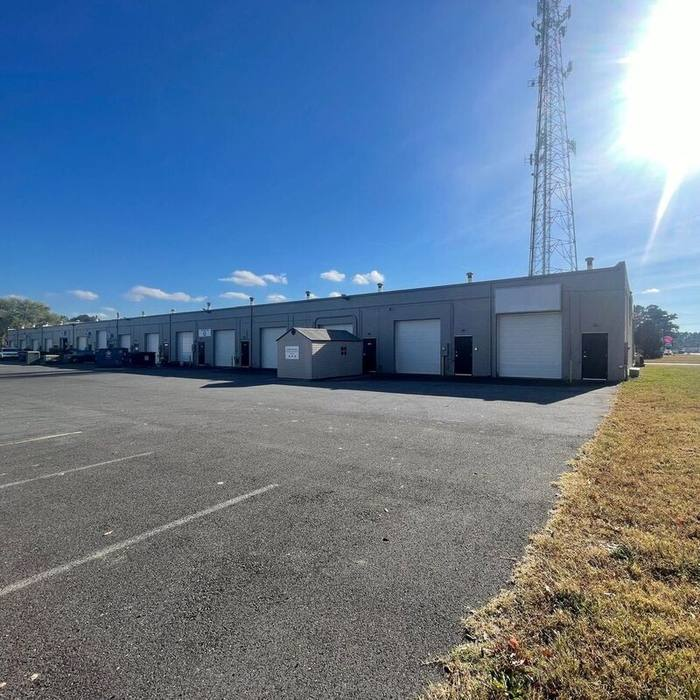
            <span class="as-card__badge as-card__badge--available">1 Space</span>
          </div>
          <div class="as-card__body">
            <h2 class="as-card__title">Northwood Business Center</h2>
            <div class="as-card__subtitle">2203 Northwood Dr</div>
            <div class="as-card__address">
              <svg width="12" height="12" viewBox="0 0 24 24" fill="none" stroke="currentColor" stroke-width="2" aria-hidden="true"><path d="M21 10c0 7-9 13-9 13S3 17 3 10a9 9 0 0 1 18 0z"/><circle cx="12" cy="10" r="3"/></svg>
              Easton, MD
            </div>
            <div class="as-card__stats">
              <span class="as-card__stat">2,400 SF total</span>
              <span class="as-card__stat">Flex</span>
              <span class="as-card__stat">Maryland</span>
            </div>
            <div class="as-card__single-unit">
              <div class="as-unit-inline">
                <div><span class="as-unit__label">Suite</span> A1-2</div>
                <div><span class="as-unit__label">Size</span> 1,200&ndash;2,400 SF</div>
                <div><span class="as-unit__label">Asking</span> $10.99 <span class="as-unit__rate-type">+UTIL</span></div>
              </div>
            </div>
            <div class="as-card__footer">
              <a href="mailto:info@oxfordra.net?subject=Inquiry%20-%20Northwood%20Business%20Center" class="as-card__cta" aria-label="Inquire about Northwood Business Center">Inquire</a>
              <a href="tel:+13015126125" class="as-card__phone" title="Call 301.512.6125">
                <svg width="14" height="14" viewBox="0 0 24 24" fill="none" stroke="currentColor" stroke-width="2" aria-hidden="true"><path d="M22 16.92v3a2 2 0 01-2.18 2 19.79 19.79 0 01-8.63-3.07 19.5 19.5 0 01-6-6A19.79 19.79 0 012.12 4.18 2 2 0 014.11 2h3a2 2 0 012 1.72c.127.96.362 1.903.7 2.81a2 2 0 01-.45 2.11L8.09 9.91a16 16 0 006 6l1.27-1.27a2 2 0 012.11-.45c.907.338 1.85.573 2.81.7A2 2 0 0122 16.92z"/></svg>
              </a>
            </div>
          </div>
        </article>
        <article class="as-card" data-id="5">
          <div class="as-card__img">
            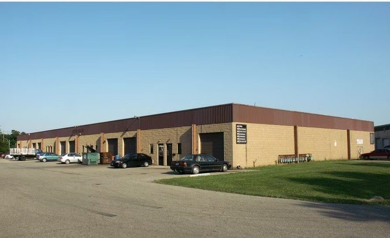
            <span class="as-card__badge as-card__badge--available">1 Space</span>
          </div>
          <div class="as-card__body">
            <h2 class="as-card__title">2800-2826 Banwick Rd</h2>
            <div class="as-card__address">
              <svg width="12" height="12" viewBox="0 0 24 24" fill="none" stroke="currentColor" stroke-width="2" aria-hidden="true"><path d="M21 10c0 7-9 13-9 13S3 17 3 10a9 9 0 0 1 18 0z"/><circle cx="12" cy="10" r="3"/></svg>
              Columbus, OH
            </div>
            <div class="as-card__stats">
              <span class="as-card__stat">1,500 SF total</span>
              <span class="as-card__stat">Flex</span>
              <span class="as-card__stat">Columbus</span>
            </div>
            <div class="as-card__single-unit">
              <div class="as-unit-inline">
                <div><span class="as-unit__label">Suite</span> 2814</div>
                <div><span class="as-unit__label">Size</span> 1,500 SF</div>
                <div><span class="as-unit__label">Asking</span> $13.60 <span class="as-unit__rate-type">MG</span></div>
              </div>
            </div>
            <div class="as-card__footer">
              <a href="mailto:info@oxfordra.net?subject=Inquiry%20-%202800-2826%20Banwick%20Rd" class="as-card__cta" aria-label="Inquire about 2800-2826 Banwick Rd">Inquire</a>
              <a href="tel:+13015126125" class="as-card__phone" title="Call 301.512.6125">
                <svg width="14" height="14" viewBox="0 0 24 24" fill="none" stroke="currentColor" stroke-width="2" aria-hidden="true"><path d="M22 16.92v3a2 2 0 01-2.18 2 19.79 19.79 0 01-8.63-3.07 19.5 19.5 0 01-6-6A19.79 19.79 0 012.12 4.18 2 2 0 014.11 2h3a2 2 0 012 1.72c.127.96.362 1.903.7 2.81a2 2 0 01-.45 2.11L8.09 9.91a16 16 0 006 6l1.27-1.27a2 2 0 012.11-.45c.907.338 1.85.573 2.81.7A2 2 0 0122 16.92z"/></svg>
              </a>
            </div>
          </div>
        </article>
        <article class="as-card" data-id="6">
          <div class="as-card__img">
            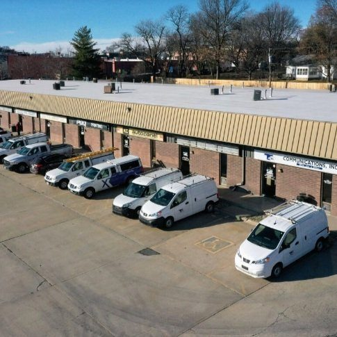
            <span class="as-card__badge as-card__badge--available">2 Spaces</span>
          </div>
          <div class="as-card__body">
            <h2 class="as-card__title">9620 E State Route 350</h2>
            <div class="as-card__address">
              <svg width="12" height="12" viewBox="0 0 24 24" fill="none" stroke="currentColor" stroke-width="2" aria-hidden="true"><path d="M21 10c0 7-9 13-9 13S3 17 3 10a9 9 0 0 1 18 0z"/><circle cx="12" cy="10" r="3"/></svg>
              Raytown, MO
            </div>
            <div class="as-card__stats">
              <span class="as-card__stat">8,610 SF total</span>
              <span class="as-card__stat">Retail</span>
              <span class="as-card__stat">Kansas City</span>
            </div>
            <button class="as-card__expand" data-id="6" aria-expanded="false">
              <span>View 2 Available Spaces</span>
              <svg width="12" height="12" viewBox="0 0 12 12" fill="none" stroke="currentColor" stroke-width="1.5" aria-hidden="true"><path d="M3 4.5L6 7.5L9 4.5"/></svg>
            </button>
            <div class="as-card__units">
              <div class="as-unit" data-pid="6" data-suite="107-108">
                <div class="as-unit__suite"><span class="as-unit__label">Suite</span>107-108</div>
                <div class="as-unit__sf"><span class="as-unit__label">Size</span>5,745 SF</div>
                <div class="as-unit__use"><span class="as-unit__label">Use</span>Retail</div>
                <div class="as-unit__rate"><span class="as-unit__label">Asking</span>$10.00 <span class="as-unit__rate-type">+UTIL</span></div>
                <a href="mailto:info@oxfordra.net?subject=Inquiry%20-%209620%20E%20State%20Route%20350%20Suite%20107-108" class="as-unit__inquire" aria-label="Inquire about Suite 107-108 at 9620 E State Route 350">Inquire</a>
              </div>
              <div class="as-unit" data-pid="6" data-suite="110">
                <div class="as-unit__suite"><span class="as-unit__label">Suite</span>110</div>
                <div class="as-unit__sf"><span class="as-unit__label">Size</span>2,865 SF</div>
                <div class="as-unit__use"><span class="as-unit__label">Use</span>Retail</div>
                <div class="as-unit__rate"><span class="as-unit__label">Asking</span>$10.00 <span class="as-unit__rate-type">+UTIL</span></div>
                <a href="mailto:info@oxfordra.net?subject=Inquiry%20-%209620%20E%20State%20Route%20350%20Suite%20110" class="as-unit__inquire" aria-label="Inquire about Suite 110 at 9620 E State Route 350">Inquire</a>
              </div>
            </div>
            <div class="as-card__footer">
              <a href="mailto:info@oxfordra.net?subject=Inquiry%20-%209620%20E%20State%20Route%20350" class="as-card__cta" aria-label="Inquire about 9620 E State Route 350">Inquire</a>
              <a href="tel:+13015126125" class="as-card__phone" title="Call 301.512.6125">
                <svg width="14" height="14" viewBox="0 0 24 24" fill="none" stroke="currentColor" stroke-width="2" aria-hidden="true"><path d="M22 16.92v3a2 2 0 01-2.18 2 19.79 19.79 0 01-8.63-3.07 19.5 19.5 0 01-6-6A19.79 19.79 0 012.12 4.18 2 2 0 014.11 2h3a2 2 0 012 1.72c.127.96.362 1.903.7 2.81a2 2 0 01-.45 2.11L8.09 9.91a16 16 0 006 6l1.27-1.27a2 2 0 012.11-.45c.907.338 1.85.573 2.81.7A2 2 0 0122 16.92z"/></svg>
              </a>
            </div>
          </div>
        </article>
        <div class="as-no-results" id="noResults" style="display:none;">
          <p>No listings match your filters. Try adjusting your search criteria.</p>
        </div>
      </div>
```

This markup is byte-for-byte what `listings.js`'s `cardHTML()` function (`listings.js:191-245`) produces for the current `LISTINGS` array in unexpanded, grid-view state — so `renderCards()` overwriting it on load is a no-op visually.

- [ ] **Step 3: Verify the fix**

Run: `grep -c 'as-card"' available-space.html`
Expected: `6`.

- [ ] **Step 4: Add a maintenance-note comment to listings.js**

In `listings.js`, immediately above line 9 (`// ── Property Data (current availabilities only) ──────────────────────────────`), add:

```javascript
  // NOTE: When adding/removing/editing a listing here, also update the static
  // fallback cards in available-space.html's #listingsPanel (id="listing-schema"
  // JSON-LD too) — that markup is what AI/search crawlers see before this script
  // runs, and there is no build step to generate it automatically.
```

- [ ] **Step 5: Verify JS interactivity is unchanged**

Start the preview server (Task 1's `static-preview` config) if not already running, then:
- `preview_snapshot` on `http://localhost:8899/available-space` — confirm 6 property cards are present and match the static markup.
- `preview_click` on the "View 2 Available Spaces" expand button for `2000-2002 Zettler Rd` — confirm it expands to show both units (proves `renderCards()` re-render and `bindCardEvents` still work against the new initial markup).
- Type "Raytown" into the search input (`#searchInput`) via `preview_fill` and confirm the panel filters down to the one Kansas City listing (proves `applyFilters()` still works).

- [ ] **Step 6: Populate the listing-schema JSON-LD with real data**

Replace, in `available-space.html`:

```html
    <script type="application/ld+json" id="listing-schema">{}</script>
```

with:

```html
    <script type="application/ld+json" id="listing-schema">
    {
      "@context": "https://schema.org",
      "@type": "ItemList",
      "name": "Available Industrial and Flex Space | Oxford Realty Advisors",
      "itemListElement": [
        {"@type": "ListItem", "position": 1, "item": {"@type": "Offer", "name": "2012-2026 Zettler Rd, Suite 2016", "url": "https://oxfordra.net/available-space#2012-2026-zettler-rd", "businessFunction": "http://purl.org/goodrelations/v1#LeaseOut", "price": "11.67", "priceCurrency": "USD", "priceSpecification": {"@type": "UnitPriceSpecification", "price": "11.67", "priceCurrency": "USD", "unitText": "per SF per year, modified gross"}, "itemOffered": {"@type": "Place", "name": "2012-2026 Zettler Rd", "address": {"@type": "PostalAddress", "addressLocality": "Columbus", "addressRegion": "OH", "addressCountry": "US"}, "floorSize": {"@type": "QuantitativeValue", "value": 1800, "unitCode": "FTK"}}}},
        {"@type": "ListItem", "position": 2, "item": {"@type": "Offer", "name": "384-398 Morrison Rd, Suite 390", "url": "https://oxfordra.net/available-space#384-398-morrison-rd", "businessFunction": "http://purl.org/goodrelations/v1#LeaseOut", "price": "13.33", "priceCurrency": "USD", "priceSpecification": {"@type": "UnitPriceSpecification", "price": "13.33", "priceCurrency": "USD", "unitText": "per SF per year, modified gross"}, "itemOffered": {"@type": "Place", "name": "384-398 Morrison Rd", "address": {"@type": "PostalAddress", "addressLocality": "Columbus", "addressRegion": "OH", "addressCountry": "US"}, "floorSize": {"@type": "QuantitativeValue", "value": 1800, "unitCode": "FTK"}}}},
        {"@type": "ListItem", "position": 3, "item": {"@type": "Offer", "name": "2000-2002 Zettler Rd, Suite 2000", "url": "https://oxfordra.net/available-space#2000-2002-zettler-rd", "businessFunction": "http://purl.org/goodrelations/v1#LeaseOut", "price": "8.00", "priceCurrency": "USD", "priceSpecification": {"@type": "UnitPriceSpecification", "price": "8.00", "priceCurrency": "USD", "unitText": "per SF per year, triple net"}, "itemOffered": {"@type": "Place", "name": "2000-2002 Zettler Rd", "address": {"@type": "PostalAddress", "addressLocality": "Columbus", "addressRegion": "OH", "addressCountry": "US"}, "floorSize": {"@type": "QuantitativeValue", "value": 4960, "unitCode": "FTK"}}}},
        {"@type": "ListItem", "position": 4, "item": {"@type": "Offer", "name": "2000-2002 Zettler Rd, Suite 2002", "url": "https://oxfordra.net/available-space#2000-2002-zettler-rd", "businessFunction": "http://purl.org/goodrelations/v1#LeaseOut", "price": "8.00", "priceCurrency": "USD", "priceSpecification": {"@type": "UnitPriceSpecification", "price": "8.00", "priceCurrency": "USD", "unitText": "per SF per year, triple net"}, "itemOffered": {"@type": "Place", "name": "2000-2002 Zettler Rd", "address": {"@type": "PostalAddress", "addressLocality": "Columbus", "addressRegion": "OH", "addressCountry": "US"}, "floorSize": {"@type": "QuantitativeValue", "value": 6200, "unitCode": "FTK"}}}},
        {"@type": "ListItem", "position": 5, "item": {"@type": "Offer", "name": "Northwood Business Center, Suite A1-2", "url": "https://oxfordra.net/available-space#2203-northwood-dr", "businessFunction": "http://purl.org/goodrelations/v1#LeaseOut", "price": "10.99", "priceCurrency": "USD", "priceSpecification": {"@type": "UnitPriceSpecification", "price": "10.99", "priceCurrency": "USD", "unitText": "per SF per year, plus utilities"}, "itemOffered": {"@type": "Place", "name": "Northwood Business Center, 2203 Northwood Dr", "address": {"@type": "PostalAddress", "addressLocality": "Easton", "addressRegion": "MD", "addressCountry": "US"}, "floorSize": {"@type": "QuantitativeValue", "minValue": 1200, "maxValue": 2400, "unitCode": "FTK"}}}},
        {"@type": "ListItem", "position": 6, "item": {"@type": "Offer", "name": "2800-2826 Banwick Rd, Suite 2814", "url": "https://oxfordra.net/available-space#2800-2826-banwick-rd", "businessFunction": "http://purl.org/goodrelations/v1#LeaseOut", "price": "13.60", "priceCurrency": "USD", "priceSpecification": {"@type": "UnitPriceSpecification", "price": "13.60", "priceCurrency": "USD", "unitText": "per SF per year, modified gross"}, "itemOffered": {"@type": "Place", "name": "2800-2826 Banwick Rd", "address": {"@type": "PostalAddress", "addressLocality": "Columbus", "addressRegion": "OH", "addressCountry": "US"}, "floorSize": {"@type": "QuantitativeValue", "value": 1500, "unitCode": "FTK"}}}},
        {"@type": "ListItem", "position": 7, "item": {"@type": "Offer", "name": "9620 E State Route 350, Suite 107-108", "url": "https://oxfordra.net/available-space#9620-state-route-350", "businessFunction": "http://purl.org/goodrelations/v1#LeaseOut", "price": "10.00", "priceCurrency": "USD", "priceSpecification": {"@type": "UnitPriceSpecification", "price": "10.00", "priceCurrency": "USD", "unitText": "per SF per year, plus utilities"}, "itemOffered": {"@type": "Place", "name": "9620 E State Route 350", "address": {"@type": "PostalAddress", "addressLocality": "Raytown", "addressRegion": "MO", "addressCountry": "US"}, "floorSize": {"@type": "QuantitativeValue", "value": 5745, "unitCode": "FTK"}}}},
        {"@type": "ListItem", "position": 8, "item": {"@type": "Offer", "name": "9620 E State Route 350, Suite 110", "url": "https://oxfordra.net/available-space#9620-state-route-350", "businessFunction": "http://purl.org/goodrelations/v1#LeaseOut", "price": "10.00", "priceCurrency": "USD", "priceSpecification": {"@type": "UnitPriceSpecification", "price": "10.00", "priceCurrency": "USD", "unitText": "per SF per year, plus utilities"}, "itemOffered": {"@type": "Place", "name": "9620 E State Route 350", "address": {"@type": "PostalAddress", "addressLocality": "Raytown", "addressRegion": "MO", "addressCountry": "US"}, "floorSize": {"@type": "QuantitativeValue", "value": 2865, "unitCode": "FTK"}}}}
      ]
    }
    </script>
```

- [ ] **Step 7: Validate the JSON-LD**

Run: `node scripts/validate-jsonld.js available-space.html`
Expected: two `OK` lines (`BreadcrumbList` and `ItemList`), exit code 0.

- [ ] **Step 8: Commit**

```bash
git add available-space.html listings.js
git commit -m "fix: server-render available-space listings and populate listing schema for AI/search crawler visibility"
```

---

### Task 3: Entity linking (sameAs) and legacy URL redirects

**Context:** Search results surface `oxfordra.net/portfolio-1` and `oxfordra.net/about-us/our-agents` (old pre-rebuild paths) that now 404 — any inbound link equity to them is lost and retrieval systems hitting them get nothing. Separately, ORA's `RealEstateAgent`/`Organization` JSON-LD doesn't declare `sameAs` links to its existing LinkedIn, Crunchbase, and LoopNet profiles, so search/AI systems have to infer (rather than being told) that these are the same entity.

**Files:**
- Modify: `_redirects` (append two rules)
- Modify: `index.html:48-71` (`RealEstateAgent` JSON-LD)
- Modify: `about.html:56-81` (`Organization` JSON-LD)

**Interfaces:**
- Consumes: `scripts/validate-jsonld.js` from Task 1.
- Produces: nothing later tasks depend on.

- [ ] **Step 1: Verify the redirect gap**

Run: `grep -c 'portfolio-1' _redirects`
Expected: `0`.

- [ ] **Step 2: Add the legacy redirects**

In `_redirects`, after the existing "Legacy Squarespace paths" block (after the `/case-studies /track-record 301` line and before the `# SPA-style` comment), add:

```
# Legacy Wix paths (pre-2026 rebuild)
/portfolio-1        /portfolio      301
/about-us/our-agents /about         301
```

- [ ] **Step 3: Verify the redirect fix**

Run: `grep -c 'portfolio-1' _redirects`
Expected: `1`.

Run: `cat _redirects` and confirm the two new lines appear before the `/* /404.html 404` catch-all (order matters in Netlify `_redirects` — more specific rules must precede the catch-all, which they will since they're appended above it).

- [ ] **Step 4: Verify the sameAs gap**

Run: `grep -c 'sameAs' index.html about.html`
Expected: `index.html:0` and `about.html:0`.

- [ ] **Step 5: Add sameAs to index.html's RealEstateAgent schema**

In `index.html`, within the `RealEstateAgent` JSON-LD block, change:

```json
  "telephone": "+1-301-512-6125",
  "email": "info@oxfordra.net",
  "areaServed": [
```

to:

```json
  "telephone": "+1-301-512-6125",
  "email": "info@oxfordra.net",
  "sameAs": [
    "https://www.linkedin.com/company/oxford-realty-advisors",
    "https://www.crunchbase.com/organization/oxford-realty-advisors-inc",
    "https://www.loopnet.com/company/oxford-realty-advisors/potomac-md/dkrft8kl/",
    "https://www.loopnet.com/company/oxford-realty-advisors/baltimore-md/khb4zdbl/"
  ],
  "areaServed": [
```

- [ ] **Step 6: Add sameAs to about.html's Organization schema**

In `about.html`, within the `Organization` JSON-LD block, change:

```json
  "telephone": "+1-301-512-6125",
  "email": "info@oxfordra.net",
  "founder": {"@type": "Person", "name": "Eric Goldberg", "jobTitle": "Founder"},
```

to:

```json
  "telephone": "+1-301-512-6125",
  "email": "info@oxfordra.net",
  "sameAs": [
    "https://www.linkedin.com/company/oxford-realty-advisors",
    "https://www.crunchbase.com/organization/oxford-realty-advisors-inc",
    "https://www.loopnet.com/company/oxford-realty-advisors/potomac-md/dkrft8kl/",
    "https://www.loopnet.com/company/oxford-realty-advisors/baltimore-md/khb4zdbl/"
  ],
  "founder": {"@type": "Person", "name": "Eric Goldberg", "jobTitle": "Founder"},
```

- [ ] **Step 7: Validate the JSON-LD**

Run: `node scripts/validate-jsonld.js index.html && node scripts/validate-jsonld.js about.html`
Expected: all blocks `OK`, exit code 0 for both.

- [ ] **Step 8: Verify the sameAs fix and sanity-check the URLs**

Run: `grep -c 'sameAs' index.html about.html`
Expected: `index.html:1` and `about.html:1` (grep counts matching lines, not array entries).

Manually open the four `sameAs` URLs in a browser and confirm each shows Oxford Realty Advisors (name, Potomac MD address, or matching buy-box description) before committing — these were sourced from live web search during the audit and were not independently re-verified against LoopNet/Crunchbase (both blocked automated fetch during the audit).

- [ ] **Step 9: Commit**

```bash
git add _redirects index.html about.html
git commit -m "fix: add sameAs entity links and redirect two dead legacy URLs"
```

---

### Task 4: Columbus, OH market landing page

**Context:** No page on the site answers "who buys shallow-bay industrial in Columbus" as a standalone, citable unit — the closest is one paragraph buried in `for-brokers.html`'s FAQ. Columbus is ORA's largest and most content-rich market (`portfolio.html:489` shows a published count of 14 properties, with 10 individually pictured). This task creates `/markets/columbus-oh` as the first instance of a repeatable market-page pattern, using data already published on `portfolio.html` — no new facts are introduced.

**Files:**
- Create: `markets/columbus-oh.html`
- Modify: `sitemap.xml` (add one `<url>` entry)
- Modify: `portfolio.html` (link the existing Columbus market-card to the new page)
- Modify: `scripts/build-dist.mjs` (classify the new `markets/` directory, once it has real content)

**Interfaces:**
- Consumes: `scripts/validate-jsonld.js` from Task 1; the `.subpage-hero`, `.criteria-list`, `.portfolio-card` CSS classes already defined in `styles.css` (confirmed present via `grep -l` in this plan's research phase).
- Produces: nothing later tasks depend on — this is the first of what the audit recommends become a repeatable per-market page pattern (Cincinnati, Kansas City, Indianapolis, Madison as those markets activate), but only Columbus is in scope here.

- [ ] **Step 1: Verify the gap**

Run: `test -f markets/columbus-oh.html && echo EXISTS || echo MISSING`
Expected: `MISSING`.

- [ ] **Step 2: Create the Columbus market page**

Write `markets/columbus-oh.html`:

```html
<!DOCTYPE html>
<html lang="en">
<head>
<meta charset="utf-8">
<meta name="viewport" content="width=device-width, initial-scale=1">
<title>Shallow-Bay Industrial Buyer in Columbus, Ohio | Oxford Realty Advisors</title>
<meta name="description" content="Oxford Realty Advisors owns 14+ shallow-bay industrial and flex properties in Columbus, Ohio near I-70/I-270. All-cash buyer for Class B/C industrial, $1M-$10M. Submit a deal in 48 hours.">
<link rel="canonical" href="https://oxfordra.net/markets/columbus-oh">
<meta property="og:title" content="Shallow-Bay Industrial Buyer in Columbus, Ohio | Oxford Realty Advisors">
<meta property="og:description" content="Oxford Realty Advisors owns 14+ shallow-bay industrial and flex properties in Columbus, Ohio near I-70/I-270. All-cash buyer for Class B/C industrial, $1M-$10M.">
<meta property="og:image" content="https://oxfordra.net/images/og-image.png">
<meta property="og:image:width" content="1200">
<meta property="og:image:height" content="630">
<meta property="og:url" content="https://oxfordra.net/markets/columbus-oh">
<meta property="og:type" content="website">
<meta property="og:site_name" content="Oxford Realty Advisors">
<meta name="twitter:card" content="summary_large_image">
<meta name="twitter:title" content="Shallow-Bay Industrial Buyer in Columbus, Ohio | Oxford Realty Advisors">
<meta name="twitter:description" content="Oxford Realty Advisors owns 14+ shallow-bay industrial and flex properties in Columbus, Ohio near I-70/I-270.">
<meta name="twitter:image" content="https://oxfordra.net/images/og-image.png">
<meta name="robots" content="index, follow">
<meta name="theme-color" content="#1B2A4A">
<link rel="icon" type="image/x-icon" href="/favicon.ico">
<link rel="icon" type="image/png" href="/favicon.png">
<link rel="apple-touch-icon" sizes="180x180" href="/apple-touch-icon.png">
<link rel="manifest" href="/manifest.json">
<link rel="preload" as="image" type="image/avif" href="/images/17-warehouse-columbus-external.avif">
<link rel="preload" as="font" type="font/woff2" href="/fonts/dm-sans-latin.woff2" crossorigin>
<link rel="preload" as="font" type="font/woff2" href="/fonts/eb-garamond-latin.woff2" crossorigin>
<link rel="preload" as="font" type="font/woff2" href="/fonts/eb-garamond-italic-latin.woff2" crossorigin>
<link rel="preload" as="font" type="font/woff2" href="/fonts/ibm-plex-mono-latin.woff2" crossorigin>
<link rel="stylesheet" href="/styles.css?v=14">
<script type="application/ld+json">
{
  "@context": "https://schema.org",
  "@type": "BreadcrumbList",
  "itemListElement": [
    {"@type": "ListItem", "position": 1, "name": "Home", "item": "https://oxfordra.net/"},
    {"@type": "ListItem", "position": 2, "name": "Portfolio", "item": "https://oxfordra.net/portfolio"},
    {"@type": "ListItem", "position": 3, "name": "Columbus, OH", "item": "https://oxfordra.net/markets/columbus-oh"}
  ]
}
</script>
<script type="application/ld+json">
{
  "@context": "https://schema.org",
  "@type": "FAQPage",
  "mainEntity": [
    {"@type": "Question", "name": "Does Oxford Realty Advisors buy industrial and flex properties in Columbus, Ohio?", "acceptedAnswer": {"@type": "Answer", "text": "Yes. Columbus is one of Oxford's four core markets. Oxford currently owns 14+ shallow-bay industrial and flex properties in Columbus, concentrated along the Zettler Road, Banwick Road, Morrison Road, Rarig Avenue, Westerville Road, and East Fifth Avenue corridors near the I-70/I-270 interchange."}},
    {"@type": "Question", "name": "What size industrial buildings does Oxford buy in Columbus?", "acceptedAnswer": {"@type": "Answer", "text": "Oxford targets Class B/C industrial and flex buildings under 50,000 SF, in the $1M-$10M transaction size, with 18-foot-plus clear height preferred. Portfolio deals within this range are welcome."}},
    {"@type": "Question", "name": "Does Oxford buy vacant or distressed industrial properties in Columbus?", "acceptedAnswer": {"@type": "Answer", "text": "Yes. Oxford sizes offers against stabilized potential, not current occupancy, and has acquired Columbus buildings with vacancy, deferred maintenance, and environmental complexity that lenders will not finance. Oxford's 100% all-cash structure removes the financing contingency that causes traditional buyers to walk from these situations."}},
    {"@type": "Question", "name": "How fast can Oxford close on a Columbus property?", "acceptedAnswer": {"@type": "Answer", "text": "Oxford routinely closes 30-45 days from LOI execution, with a fastest close of 28 days, because acquisitions use 100% proprietary family capital with no lender approval process."}},
    {"@type": "Question", "name": "Who do I contact to sell an industrial or flex property in Columbus?", "acceptedAnswer": {"@type": "Answer", "text": "Brokers and owners can submit a deal directly to Oxford Realty Advisors at info@oxfordra.net or 301.512.6125. Every submission receives a preliminary indication of interest within 48 hours."}}
  ]
}
</script>
<style>
@font-face{font-family:'DM Sans';src:url('/fonts/dm-sans-latin.woff2') format('woff2');font-weight:400;font-style:normal;font-display:swap}
@font-face{font-family:'EB Garamond';src:url('/fonts/eb-garamond-latin.woff2') format('woff2');font-weight:500;font-style:normal;font-display:swap}
@font-face{font-family:'EB Garamond';src:url('/fonts/eb-garamond-italic-latin.woff2') format('woff2');font-weight:400;font-style:italic;font-display:swap}
:root{--navy:#1B2A4A;--navy-dark:#141F33;--gold:#C9A96E;--gold-light:#D4B87E;--parchment:#F5F3EF;--white:#fff;--charcoal:#2D2D2D;--slate:#596B7D;--light-gray:#E8E4DE;--divider:rgba(201,169,110,.3);--shadow-card:0 2px 8px rgba(27,42,74,.08);--shadow-hover:0 8px 32px rgba(27,42,74,.16);--radius-card:8px;--radius-btn:6px;--transition:.3s ease;--font-display:'EB Garamond',Georgia,'Times New Roman',serif;--font-body:'DM Sans',-apple-system,BlinkMacSystemFont,'Segoe UI',sans-serif}
*,*::before,*::after{box-sizing:border-box;margin:0;padding:0}
html{scroll-behavior:smooth;-webkit-text-size-adjust:100%}
body{font-family:var(--font-body);font-size:16px;line-height:1.7;color:var(--charcoal);background:var(--white);-webkit-font-smoothing:antialiased;-moz-osx-font-smoothing:grayscale}
img{max-width:100%;display:block;height:auto}
a{text-decoration:none;color:var(--gold);transition:color var(--transition)}
a:hover{text-decoration:underline}
button{font-family:inherit}
:focus-visible{outline:2px solid var(--gold);outline-offset:2px}
a:focus:not(:focus-visible),button:focus:not(:focus-visible){outline:none}
h1,h2,h3{font-family:var(--font-display);font-weight:400;color:var(--navy);line-height:1.2}
h2{font-size:28px;margin-bottom:16px}
h3{font-size:22px;margin-bottom:8px}
.text-white{color:var(--white)}.text-white-muted{color:rgba(255,255,255,.7)}
.container{max-width:1280px;margin:0 auto;padding:0 24px}
.section{padding:64px 0}.section--navy{background:var(--navy);color:var(--white)}.section--navy h2,.section--navy h3{color:var(--white)}.section--parchment{background:var(--parchment)}
.grid-2{display:grid;grid-template-columns:1fr;gap:32px}.grid-3{display:grid;grid-template-columns:1fr;gap:24px}
.section__header{text-align:center;margin-bottom:48px}
.section__label{display:block;font-family:var(--font-body);font-size:12px;font-weight:500;text-transform:uppercase;letter-spacing:.2em;color:var(--gold);margin-bottom:12px}
.section__label--light{color:rgba(201,169,110,.8)}
.section__intro{font-family:var(--font-display);font-size:18px;color:var(--slate);margin-top:-8px}
.section--navy .section__intro{color:rgba(255,255,255,.6)}
.animate-on-scroll{opacity:0;transform:translateY(24px);transition:opacity .6s ease,transform .6s ease}
.animate-on-scroll.is-visible{opacity:1;transform:translateY(0)}
.hidden{display:none}.sr-only{position:absolute;width:1px;height:1px;padding:0;margin:-1px;overflow:hidden;clip:rect(0,0,0,0);white-space:nowrap;border:0}
.btn{display:inline-flex;align-items:center;justify-content:center;font-family:var(--font-body);font-size:13px;font-weight:500;text-transform:uppercase;letter-spacing:.12em;padding:14px 32px;border-radius:6px;border:1px solid transparent;cursor:pointer;transition:all .3s;text-decoration:none}
.btn:hover{text-decoration:none}
.btn--gold{background:var(--gold);color:var(--navy);border-color:var(--gold)}
.btn--gold:hover{background:#b8963e;border-color:#b8963e}
.btn--outline{background:transparent;color:var(--gold);border-color:var(--gold)}
.btn--outline:hover{background:var(--gold);color:var(--navy)}
.skip-link{position:absolute;top:-100px;left:0;z-index:1001;background:var(--gold);color:var(--navy);padding:12px 24px;font-family:var(--font-body);font-size:14px;font-weight:500;border-radius:0 0 6px 0}
.skip-link:focus{top:0}
.nav{position:fixed;top:0;left:0;right:0;z-index:1000;background:var(--navy);border-bottom:1px solid rgba(201,169,110,.15)}
.nav__inner{max-width:1280px;margin:0 auto;padding:0 40px;height:72px;display:flex;align-items:center;justify-content:space-between}
.nav__logo img,.nav__logo svg{height:auto;width:auto;max-height:28px;display:block}
.nav__links{display:flex;gap:0;align-items:center}
.nav__link{font-family:var(--font-body);font-size:.75rem;font-weight:500;text-transform:uppercase;letter-spacing:.14em;color:rgba(255,255,255,.8);padding:6px 14px;transition:color .3s}
.nav__link:hover,.nav__link:focus{color:var(--gold);text-decoration:none}
.nav__link--active{color:var(--gold)}
.nav__link--cta{background:var(--gold);color:var(--navy);border-radius:6px;padding:8px 18px;font-size:.75rem;letter-spacing:.14em;font-weight:500;text-transform:uppercase;margin-left:8px}
.nav__link--cta:hover{background:#b8963e;color:var(--navy);text-decoration:none}
.nav__mobile-btn{display:none;background:none;border:0;cursor:pointer;padding:8px}
.nav__mobile-btn span{display:block;width:22px;height:2px;background:var(--white);margin-bottom:5px;transition:transform .3s}
.nav__mobile-btn span:last-child{width:16px;background:var(--gold);margin-bottom:0}
.nav__mobile{display:none;background:var(--navy);padding:16px 40px 24px}
.nav__mobile.is-open{display:block}
.nav__mobile a{display:block;padding:12px 0;font-family:var(--font-body);font-size:13px;font-weight:500;text-transform:uppercase;letter-spacing:.12em;color:var(--white);border-bottom:1px solid rgba(255,255,255,.06)}
.nav__mobile a:hover{color:var(--gold);text-decoration:none}
@media(max-width:960px){.nav__links{display:none}.nav__mobile-btn{display:block}.nav__inner{padding:0 24px}}
@media(min-width:768px){h1{font-size:44px}h2{font-size:36px}h3{font-size:24px}.container{padding:0 32px}.section{padding:80px 0}.grid-2{grid-template-columns:1fr 1fr;gap:40px}}
@media(min-width:1024px){h1{font-size:56px}h2{font-size:40px}h3{font-size:28px}.container{padding:0 40px}.section{padding:96px 0}.grid-3{grid-template-columns:1fr 1fr 1fr}}
@media(prefers-reduced-motion:reduce){*,*::before,*::after{animation-duration:.01ms;animation-iteration-count:1;transition-duration:.01ms;scroll-behavior:auto}.animate-on-scroll{opacity:1;transform:none}}
</style>
<link rel="stylesheet" href="/assets/chat.css" media="print" id="chat-css-async">
<script>(function(){var l=document.getElementById("chat-css-async");if(l){requestAnimationFrame(function(){l.media="all";l.removeAttribute("id")})}})();</script>
</head>
<body>

<a href="#main-content" class="skip-link">Skip to main content</a>

<header role="banner">
<div class="announcement-bar" role="region" aria-label="What we're buying now">
<span class="announcement-bar__label">What We're Buying Now</span>
<span class="announcement-bar__sep" aria-hidden="true">·</span>
<span class="announcement-bar__rotator" aria-live="polite">
<span class="announcement-bar__item is-active">Actively seeking $1M&ndash;$10M acquisitions</span>
<span class="announcement-bar__item">Shallow-bay industrial / flex</span>
<span class="announcement-bar__item">Mid-Atlantic and Midwest</span>
<span class="announcement-bar__item">All-cash closings in 30&ndash;45 days</span>
</span>
</div>
<nav class="nav" aria-label="Primary navigation">
<div class="nav__inner">
<a href="/" class="nav__logo" aria-label="Oxford Realty Advisors — Home">
<svg width="448" height="56" viewBox="0 0 448 56" fill="#fff" xmlns="http://www.w3.org/2000/svg" aria-hidden="true"><g><rect x="28" y="8" width="12" height="12"/><rect x="14" y="22" width="12" height="12"/><rect x="28" y="22" width="12" height="12"/><rect x="0" y="36" width="12" height="12"/><rect x="14" y="36" width="12" height="12"/><rect x="28" y="36" width="12" height="12"/></g><text x="56" y="42" font-family="'EB Garamond', Georgia, serif" font-size="42" font-weight="500" letter-spacing="1">OXFORD</text><text x="252" y="42" font-family="'EB Garamond', Georgia, serif" font-size="40" opacity="0.5">|</text><text x="270" y="42" font-family="'EB Garamond', Georgia, serif" font-size="25" font-style="italic">Realty Advisors</text></svg>
</a>
<div class="nav__links">
<a href="/about" class="nav__link">The Firm</a>
<a href="/portfolio" class="nav__link">Portfolio</a>
<a href="/track-record" class="nav__link">Track Record</a>
<a href="/for-brokers" class="nav__link">Broker Network</a>
<a href="/available-space" class="nav__link">Available Space</a>
<a href="/tenant-resources" class="nav__link">Tenant Resources</a>
<a href="/contact" class="nav__link">Contact</a>
<a href="/tenant-application" class="nav__link nav__link--cta">Apply Now</a>
</div>
<button class="nav__mobile-btn" aria-label="Toggle navigation" aria-expanded="false" aria-controls="mobileNav">
<span></span><span></span><span></span>
</button>
</div>
<div class="nav__mobile" id="mobileNav" aria-label="Mobile navigation">
<a href="/about">The Firm</a>
<a href="/portfolio">Portfolio</a>
<a href="/track-record">Track Record</a>
<a href="/for-brokers">Broker Network</a>
<a href="/available-space">Available Space</a>
<a href="/tenant-resources">Tenant Resources</a>
<a href="/contact">Contact</a>
<a href="/tenant-application">Apply Now</a>
</div>
</nav>
</header>

<main id="main-content">

<section class="subpage-hero" aria-label="Columbus, Ohio industrial buyer">
<div class="subpage-hero__bg">
<picture>
<source type="image/avif" srcset="/images/17-warehouse-columbus-external.avif">
<source type="image/webp" srcset="/images/17-warehouse-columbus-external.webp">

</picture>
</div>
<div class="subpage-hero__overlay"></div>
<div class="subpage-hero__content">
<span class="section__label section__label--light">Columbus, Ohio</span>
<h1>Shallow-Bay Industrial Buyer in Columbus</h1>
<p class="hero-motto" style="margin-top:20px;font-family:var(--font-display);font-size:20px;font-style:italic;color:var(--gold);letter-spacing:.02em"><span style="margin-right:4px">—</span> 14+ properties owned near I-70/I-270. All-cash. 30-day close.</p>
<p>Oxford Realty Advisors is a principal buyer of Class B/C industrial and flex space in the Columbus, Ohio metro &mdash; not a broker, not a fund. One call, one decision-maker.</p>
</div>
</section>

<section class="section" aria-label="Columbus footprint">
<div class="container">
<div class="section__header animate-on-scroll">
<span class="section__label">The Footprint</span>
<h2>14+ Properties in Columbus</h2>
<p class="section__intro">Zettler &middot; Banwick &middot; Morrison &middot; Rarig &middot; Westerville &middot; East Fifth</p>
</div>
<div class="animate-on-scroll" style="max-width:820px;margin:0 auto;text-align:center">
<p style="font-size:17px;line-height:1.8;">Oxford has owned and operated shallow-bay industrial and flex space in Columbus since expanding beyond the Mid-Atlantic, concentrated in the I-70/I-270 industrial corridor. Every acquisition was purchased with 100% family capital &mdash; no financing contingency, no lender-driven walk-aways on vacancy, deferred maintenance, or environmental complexity.</p>
</div>
</div>
</section>

<section class="section section--parchment" aria-label="Columbus portfolio">
<div class="container">
<div class="section__header animate-on-scroll">
<span class="section__label">Portfolio</span>
<h2>Representative Columbus Holdings</h2>
</div>
<div class="grid-3">
<div class="portfolio-card animate-on-scroll" data-market="Ohio">
<picture>
<source type="image/avif" srcset="/images/09-3540-rear-exterior-1.avif">
<source type="image/webp" srcset="/images/09-3540-rear-exterior-1.webp">
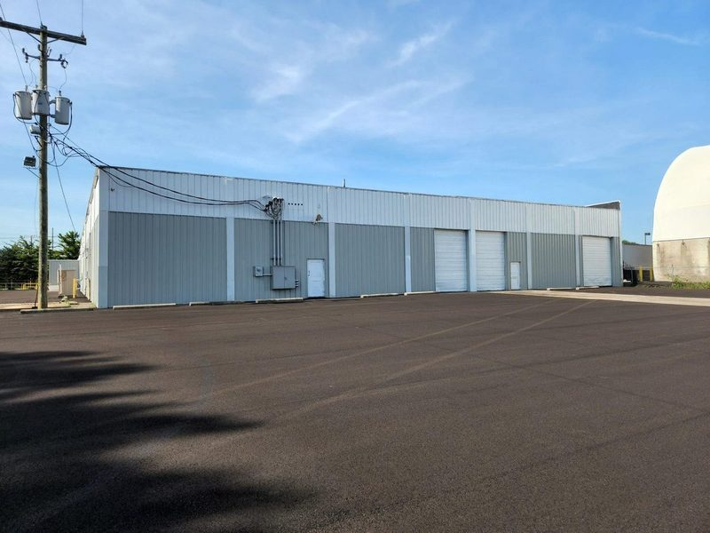
</picture>
<div class="portfolio-card__body">
<h3>3540 E Fifth Avenue</h3>
<p class="portfolio-card__location">Columbus, OH</p>
<div class="portfolio-card__meta"><span>36,000 SF</span><span>Industrial</span></div>
</div>
</div>
<div class="portfolio-card animate-on-scroll" data-market="Ohio">
<picture>
<source type="image/avif" srcset="/images/04-1100-rarig-exterior-2-drive-ins-dock.avif">
<source type="image/webp" srcset="/images/04-1100-rarig-exterior-2-drive-ins-dock.webp">
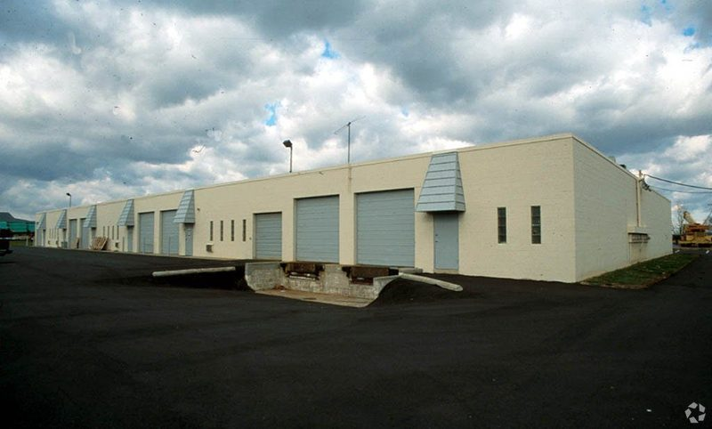
</picture>
<div class="portfolio-card__body">
<h3>1100 Rarig Avenue</h3>
<p class="portfolio-card__location">Columbus, OH</p>
<div class="portfolio-card__meta"><span>21,000 SF</span><span>Industrial/Flex</span></div>
</div>
</div>
<div class="portfolio-card animate-on-scroll" data-market="Ohio">
<picture>
<source type="image/avif" srcset="/images/01-2800-2826-banwick-exterior.avif">
<source type="image/webp" srcset="/images/01-2800-2826-banwick-exterior.webp">

</picture>
<div class="portfolio-card__body">
<h3>2800-2826 Banwick Rd</h3>
<p class="portfolio-card__location">Columbus, OH</p>
<div class="portfolio-card__meta"><span>24,000 SF</span><span>Industrial/Flex</span></div>
</div>
</div>
<div class="portfolio-card animate-on-scroll" data-market="Ohio">
<picture>
<source type="image/avif" srcset="/images/07-2000_2002-front.avif">
<source type="image/webp" srcset="/images/07-2000_2002-front.webp">

</picture>
<div class="portfolio-card__body">
<h3>2000-2008 Zettler Rd</h3>
<p class="portfolio-card__location">Columbus, OH</p>
<div class="portfolio-card__meta"><span>29,600 SF</span><span>Industrial/Flex</span></div>
</div>
</div>
<div class="portfolio-card animate-on-scroll" data-market="Ohio">
<picture>
<source type="image/avif" srcset="/images/10-zettler-2012-2026-exterior-.avif">
<source type="image/webp" srcset="/images/10-zettler-2012-2026-exterior-.webp">

</picture>
<div class="portfolio-card__body">
<h3>2012-2026 Zettler Rd</h3>
<p class="portfolio-card__location">Columbus, OH</p>
<div class="portfolio-card__meta"><span>16,800 SF</span><span>Industrial/Flex</span></div>
</div>
</div>
<div class="portfolio-card animate-on-scroll" data-market="Ohio">
<picture>
<source type="image/avif" srcset="/images/17-warehouse-columbus-external.avif">
<source type="image/webp" srcset="/images/17-warehouse-columbus-external.webp">

</picture>
<div class="portfolio-card__body">
<h3>384-420 Morrison Rd</h3>
<p class="portfolio-card__location">Columbus, OH</p>
<div class="portfolio-card__meta"><span>31,200 SF</span><span>Industrial/Flex</span></div>
</div>
</div>
<div class="portfolio-card animate-on-scroll" data-market="Ohio">
<picture>
<source type="image/avif" srcset="/images/11-gate-building.avif">
<source type="image/webp" srcset="/images/11-gate-building.webp">
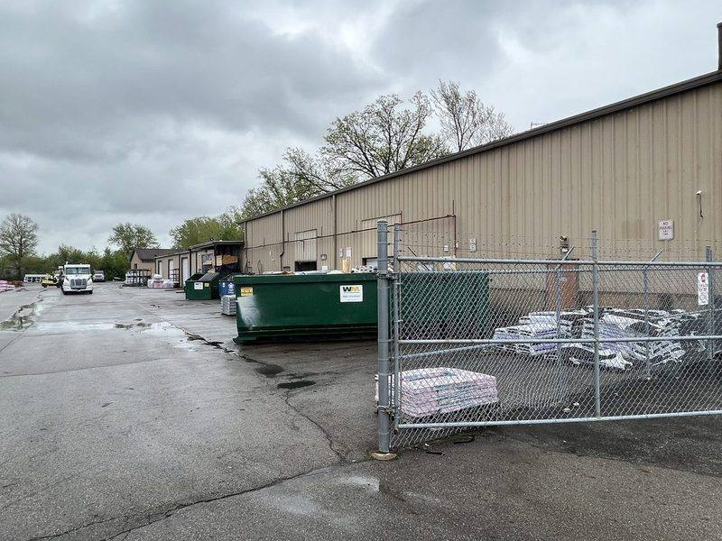
</picture>
<div class="portfolio-card__body">
<h3>3034 Westerville Rd</h3>
<p class="portfolio-card__location">Columbus, OH</p>
<div class="portfolio-card__meta"><span>18,360 SF</span><span>Industrial + IOS</span></div>
</div>
</div>
<div class="portfolio-card animate-on-scroll" data-market="Ohio">
<picture>
<source type="image/avif" srcset="/images/12-aerial-view-3875-livingston.avif">
<source type="image/webp" srcset="/images/12-aerial-view-3875-livingston.webp">
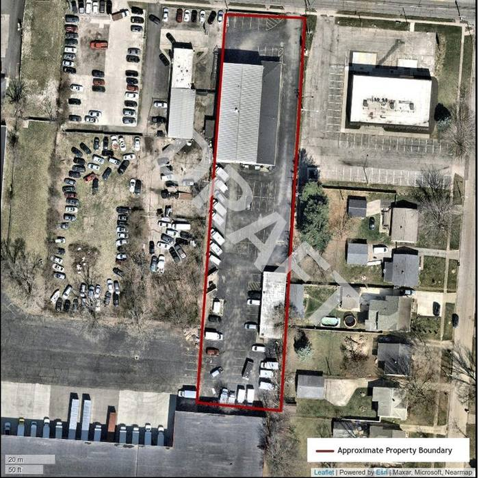
</picture>
<div class="portfolio-card__body">
<h3>3875-3883 E Livingston</h3>
<p class="portfolio-card__location">Columbus, OH</p>
<div class="portfolio-card__meta"><span>10,950 SF</span><span>Industrial + IOS</span></div>
</div>
</div>
<div class="portfolio-card animate-on-scroll" data-market="Ohio">
<picture>
<source type="image/avif" srcset="/images/19-4601-e-5th-ave-exterior-1.avif">
<source type="image/webp" srcset="/images/19-4601-e-5th-ave-exterior-1.webp">
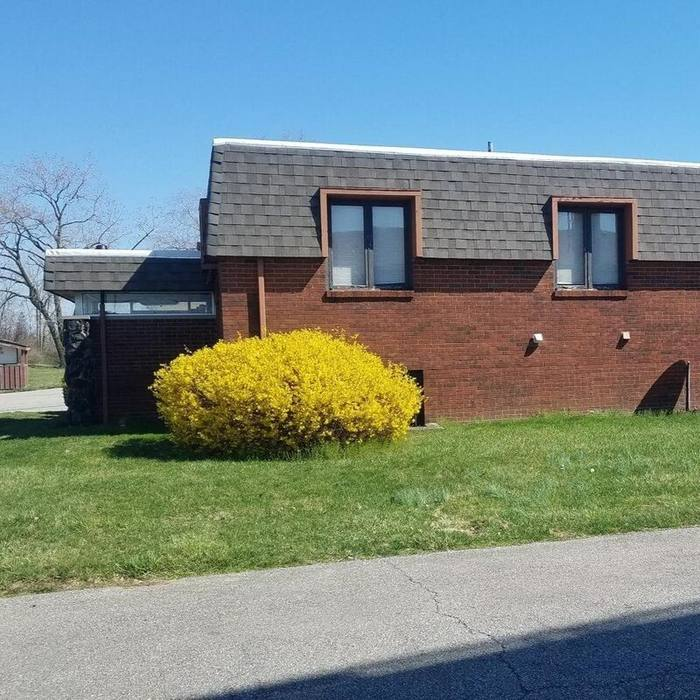
</picture>
<div class="portfolio-card__body">
<h3>4601 E Fifth Avenue</h3>
<p class="portfolio-card__location">Columbus, OH</p>
<div class="portfolio-card__meta"><span>3,300 SF</span><span>Office/Retail</span></div>
</div>
</div>
<div class="portfolio-card animate-on-scroll" data-market="Ohio">
<picture>
<source type="image/avif" srcset="/images/13-4595-towards-front-drive-in-door_.avif">
<source type="image/webp" srcset="/images/13-4595-towards-front-drive-in-door_.webp">
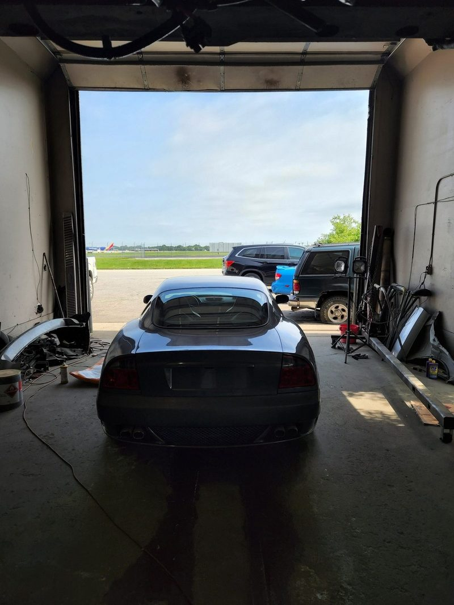
</picture>
<div class="portfolio-card__body">
<h3>4595 E Fifth Avenue</h3>
<p class="portfolio-card__location">Columbus, OH</p>
<div class="portfolio-card__meta"><span>4,100 SF</span><span>Industrial + IOS</span></div>
</div>
</div>
</div>
<div style="text-align:center;margin-top:40px" class="animate-on-scroll">
<a href="/portfolio" class="btn btn--outline">View Full Portfolio</a>
</div>
</div>
</section>

<section class="section" aria-label="Columbus acquisition criteria">
<div class="container">
<div class="section__header animate-on-scroll" style="text-align:left;max-width:1080px;margin-left:auto;margin-right:auto">
<span class="section__label">Criteria</span>
<h2>What We Look For in Columbus</h2>
</div>
<dl class="criteria-list animate-on-scroll" aria-label="Columbus acquisition criteria">
<div class="criteria-list__item">
<dt class="criteria-list__key">Deal Size</dt>
<dd class="criteria-list__value">$1M &ndash; $10M</dd>
</div>
<div class="criteria-list__item">
<dt class="criteria-list__key">Property Type</dt>
<dd class="criteria-list__value">Class B/C Industrial, Flex, Shallow-Bay, IOS</dd>
</div>
<div class="criteria-list__item">
<dt class="criteria-list__key">Building Size</dt>
<dd class="criteria-list__value">&lt; 50,000 SF per building</dd>
</div>
<div class="criteria-list__item">
<dt class="criteria-list__key">Clear Height</dt>
<dd class="criteria-list__value">18'+ preferred</dd>
</div>
<div class="criteria-list__item">
<dt class="criteria-list__key">Submarkets</dt>
<dd class="criteria-list__value">I-70/I-270 corridor &middot; Zettler &middot; Banwick &middot; Morrison &middot; Rarig &middot; Westerville &middot; East Fifth</dd>
</div>
<div class="criteria-list__item">
<dt class="criteria-list__key">Strategy</dt>
<dd class="criteria-list__value">Value-Add, Long-Term Hold</dd>
</div>
<div class="criteria-list__item">
<dt class="criteria-list__key">Acquisition Basis</dt>
<dd class="criteria-list__value">Significantly below replacement cost</dd>
</div>
<div class="criteria-list__item">
<dt class="criteria-list__key">Complexity</dt>
<dd class="criteria-list__value">Vacancy &middot; deferred maintenance &middot; environmental &amp; legal issues</dd>
</div>
</dl>
</div>
</section>

<section class="section section--navy" aria-label="Submit a Columbus deal">
<div class="container" style="text-align:center">
<div class="animate-on-scroll" style="max-width:640px;margin:0 auto">
<h2>Own Industrial or Flex Space in Columbus?</h2>
<p style="font-size:16px;color:rgba(255,255,255,.7);margin-bottom:32px;line-height:1.7">Submit your deal and get a preliminary indication of interest within 48 hours.</p>
<a href="/for-brokers#broker-network" class="btn btn--gold">Submit Your Deal</a>
</div>
</div>
</section>

</main>

<footer class="footer">
<div class="footer__inner container">
<div class="footer__brand">
<svg width="448" height="56" viewBox="0 0 448 56" fill="#fff" xmlns="http://www.w3.org/2000/svg" role="img" aria-label="Oxford Realty Advisors"><g><rect x="28" y="8" width="12" height="12"/><rect x="14" y="22" width="12" height="12"/><rect x="28" y="22" width="12" height="12"/><rect x="0" y="36" width="12" height="12"/><rect x="14" y="36" width="12" height="12"/><rect x="28" y="36" width="12" height="12"/></g><text x="56" y="42" font-family="'EB Garamond', Georgia, serif" font-size="42" font-weight="500" letter-spacing="1">OXFORD</text><text x="252" y="42" font-family="'EB Garamond', Georgia, serif" font-size="40" opacity="0.5">|</text><text x="270" y="42" font-family="'EB Garamond', Georgia, serif" font-size="25" font-style="italic">Realty Advisors</text></svg>
<p>A family-owned real estate investment firm targeting value-add industrial properties across the Mid-Atlantic and Midwest. 100% proprietary capital. Permanent holdings.</p>
</div>
<div class="footer__nav">
<p class="footer__heading">Navigate</p>
<a href="/about">The Firm</a>
<a href="/portfolio">Portfolio</a>
<a href="/track-record">Track Record</a>
<a href="/for-brokers">Broker Network</a>
<a href="/contact">Contact</a>
</div>
<div class="footer__tenants">
<p class="footer__heading">For Tenants</p>
<a href="/tenant-resources">Tenant Resources</a>
<a href="/available-space">Available Space</a>
<a href="mailto:maintenance@oxfordra.net?subject=Maintenance%20Request">Maintenance Request</a>
</div>
<div class="footer__connect">
<p class="footer__heading">Connect</p>
<a href="tel:+13015126125">301.512.6125</a>
<a href="mailto:info@oxfordra.net">info@oxfordra.net</a>
<p>9510 Persimmon Tree Road, Suite 200<br>Potomac, MD 20854</p>
</div>
</div>
<div class="footer__bottom container">
<p>&copy; 2026 Oxford Realty Advisors, LLC. All rights reserved.</p>
<div class="footer__legal">
<a href="/privacy">Privacy Policy</a>
<a href="/terms">Terms</a>
</div>
</div>
</footer>

<script defer src="/script.js?v=11"></script>
<script defer src="/assets/chat.js"></script>
</body>
</html>
```

- [ ] **Step 3: Classify markets/ in the dist allowlist**

`markets/columbus-oh.html` now exists with real content, so this is the right point to make `scripts/build-dist.mjs` publish it — classifying it any earlier (before real content existed) would have forced a throwaway placeholder file to satisfy the build's "SITE_DIRS entries must be non-empty in dist/" check (Task 1 deliberately left this for you to avoid that).

In `scripts/build-dist.mjs`, change:

```javascript
const SITE_DIRS = ['assets', 'images', 'fonts'];
```

to:

```javascript
const SITE_DIRS = ['assets', 'images', 'fonts', 'markets'];
```

- [ ] **Step 4: Validate the JSON-LD**

Run: `node scripts/validate-jsonld.js markets/columbus-oh.html`
Expected: two `OK` lines (`BreadcrumbList` and `FAQPage`), exit code 0.

- [ ] **Step 5: Browser-check the new page**

With the `static-preview` server running:
- `preview_snapshot` on `http://localhost:8899/markets/columbus-oh.html` — confirm the nav, hero ("Shallow-Bay Industrial Buyer in Columbus"), 10 portfolio cards, criteria list, and CTA all render.
- `preview_resize` to `mobile` (375x812) and re-screenshot — confirm the nav collapses to the mobile menu button without horizontal overflow (the repo's two most recent commits, `df7ec1f` and `bb407ac`, specifically fixed mobile nav overflow — this page must inherit that fix correctly since it reuses the identical nav markup).
- `preview_console_logs` — confirm no JS errors.

Note: this local server does not replicate Netlify's clean-URL rewriting, so `/markets/columbus-oh` (no `.html`) will only resolve correctly once deployed to Netlify — verify the clean URL on the eventual preview deploy, not locally.

- [ ] **Step 6: Add the page to sitemap.xml**

In `sitemap.xml`, after the `/portfolio` entry, add:

```xml
  <url><loc>https://oxfordra.net/markets/columbus-oh</loc><changefreq>monthly</changefreq><priority>0.8</priority></url>
```

- [ ] **Step 7: Link the new page from portfolio.html's Columbus market-card**

In `portfolio.html`, within the Columbus market-card (around line 487-491), change:

```html
<div class="market-card animate-on-scroll">
<span class="market-card__count">14</span>
<h3>Columbus, OH</h3>
<p>Zettler · Banwick · Morrison · Rarig · E Fifth · Westerville · Livingston · Dublin</p>
</div>
```

to:

```html
<div class="market-card animate-on-scroll">
<span class="market-card__count">14</span>
<h3>Columbus, OH</h3>
<p>Zettler · Banwick · Morrison · Rarig · E Fifth · Westerville · Livingston · Dublin</p>
<a href="/markets/columbus-oh" style="display:inline-block;margin-top:12px;font-size:12px;text-transform:uppercase;letter-spacing:.1em;font-weight:500">Columbus Overview &rarr;</a>
</div>
```

- [ ] **Step 8: Final verification sweep**

Run, for every HTML file in the repo root plus the new `markets/` file:

```bash
for f in about.html available-space.html contact.html for-brokers.html index.html portfolio.html privacy.html tenant-application.html tenant-resources.html terms.html track-record.html markets/columbus-oh.html; do node scripts/validate-jsonld.js "$f" || echo "FAILED: $f"; done
```

Expected: every file reports all blocks `OK`, no `FAILED:` lines.

- [ ] **Step 9: Confirm the new page reaches dist/**

Run: `node scripts/build-dist.mjs`
Expected: exits 0, and the "published" line includes `markets/` (Step 3 just added `'markets'` to `SITE_DIRS` — this step confirms the build actually picks it up now that real content exists).

Run: `test -f dist/markets/columbus-oh.html && echo FOUND || echo MISSING`
Expected: `FOUND`.

- [ ] **Step 10: Commit**

```bash
git add markets/columbus-oh.html sitemap.xml portfolio.html scripts/build-dist.mjs
git commit -m "feat: add Columbus, OH market landing page with FAQ schema and portfolio cross-link"
```

---

## After all tasks: preview deploy

Once Tasks 1-4 are committed, stop the local preview server (`preview_stop`) to free the port, then trigger a Netlify preview/draft deploy of the branch (not a merge to `main`) to confirm clean-URL routing for `/markets/columbus-oh` and to do a final visual pass on the live CDN. This does not require additional confirmation per standing policy (preview deploys are the default; only a production deploy of oxfordra.net needs Gabriel's explicit in-turn go-ahead).
